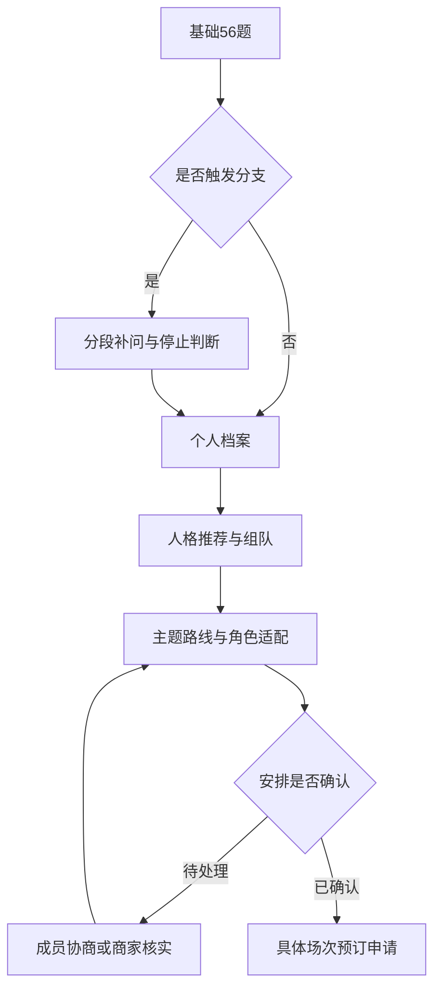

# 入戏档案：自适应人格测试、组队社交与密室主题预订完整规格

**内容版本：v2.0-dev-spec｜日期：2026-09-23｜交付类型：小程序产品、题库、规则引擎、商家协作与开发验收规范。**

文件名沿用原文档以保持引用稳定；内容版本以本页为准。本文完整替换v1.2的固定100题流程、103题编号和旧补题规则，不需要开发者再合并旧版。历史报告保留原版本，不按新版静默重算。

本版可用于产品原型、配置数据和软件实现。量表阈值、推荐权重、主题标尺与类型关系属于待试测的产品模型；规则执行正确不等于心理测量或配对效果已被验证。本文不承诺真实胆量认证、组队成功概率或门店履约保证。

## 0. 已确认方案与开发总原则

1. 基础56题，特定答案触发隐藏分支，最多追加44题；**一次人格测试最多100个题位**。不是每人固定100题，也不为了凑100而补问。
2. 五维玩法人格：A/O、D/M、L/V、H/C、K/R；16主角色、32代码组合。
3. 六星图：入戏投入、互动意愿、探索欲望、刺激偏好、动能偏好、协作意愿；不计算面积排名。
4. 坦奶身份独立于五字母，正式身份只属于巨坦、微坦、尖叫奶、哑巴奶之一。信息不足只显示待补答，不伪造第五种身份或“半坦半奶”。
5. 性别、年龄在开场填写；小孩、青年、中年三种形象档，男/女外观可手动选。人口信息不改变人格、胆量、配对得分。主题适用资格另行核验。
6. 玩家图鉴配对、真实双人匹配、多人队伍、主题/路线/角色适配、预订资格分别计算。任何同频分都不能覆盖明确拒绝。
7. 坦奶互补是候选方向；坦本人愿意协助、商家允许陪同、时间和位置可执行，才成为有效分工。
8. AI可以提取商家资料和解释规则，但不独立批准关键玩法条件、不编造答案、不决定最终预约成功。
9. 玩家端用夸张、抽象、恶搞、拟人漫画风；不做圆萌吉祥物、统一后台卡片墙或黑红血腥模板。商家工作台以清晰录入和确认优先。
10. 测试后的题材兴趣、实际组队协议、预订资料属于独立业务表单，**不伪装成100题测试里的隐藏加题**。进入各流程前说明需确认的事项。

### 0.1 产品边界与上线分期

| 阶段 | 实现范围 | 开放条件 |
|---|---|---|
| P0 私测 | 56+分支测试、报告、角色图鉴、熟人邀请、双人/多人计算、人工商家主题录入与预约申请 | 题库和规则测试通过，内部主题配置可复核 |
| P1 合作商家试点 | 商家工作台、主题版本发布、路线角色、场次、组队申请、商家确认、预约留位 | 商家确认链路和库存并发验收通过；小规模真实反馈 |
| P2 扩展社交与交易 | 自愿公开发现、陌生人申请入队、商家系统对接、支付退款 | 身份权限、举报与反骚扰、库存和交易集成单独验收；不因文档完成自动开放 |

完整规格包含各阶段，避免后续推倒重做；首版不要求一次实现所有外部系统。本文路径和字段是项目内部契约，不是微信或支付平台现行SDK承诺。具体平台接入时另按官方文档核对，不在这里虚构已可用接口。

### 0.2 阅读导航

- 产品/开发总负责人：0—3、9—16、22—24。
- 题库与算法：4—10、13—15、20、23。
- 前端/UI/内容：2、7—9、17—18。
- 商家运营：11—16、19、22。
- 后端/验收：5—6、10、14—16、19—24。

## 1. 产品闭环与信息分层

玩家完成测试后可以认识玩法、查看六维图、理解坦奶反应、分享角色卡、寻找搭子、建立队伍，再基于具体主题与场次发起预订。



信息必须分四层：

| 层 | 例子 | 更新方式 |
|---|---|---|
| 相对稳定的偏好 | 接戏、剧情、探索、刺激、运动 | 测试或主动重测，保留历史 |
| 情境画像 | 受惊失声、愿意陪同、关键演绎不玩梗 | 隐藏线/个人补充；注明适用情境 |
| 本场需求与边界 | 今天不跑动、这场希望陪同 | 每次组队确认；不得反推永久人格 |
| 实际安排与承诺 | 角色、路线、谁陪同、场次、商家确认 | 各方确认；改变后重新检查 |

## 2. 开场资料、年龄性别与题材兴趣

### 2.1 开场资料

| 字段 | 选项/校验 | 用途 |
|---|---|---|
| gender | male男/female女/undisclosed不便透露，无默认 | 默认形象；不参与评分或推荐加权 |
| age_band | child未满18/youth18—34/mature35及以上 | 三套年龄资源；不是社会学年龄结论 |
| exact_age | 可选整数0—120，映射上述年龄档 | 不公开；预约资格需要时重新确认必要信息 |
| avatar_presentation | male/female；不透露gender者自行选外观或先用剪影 | 不能通过外观反推真实性别 |
| avatar_age | child/youth/mature | 可手动换，不更改真实年龄档 |
| experience | none/1_5/6_20/21_plus | 说明经验，不加分 |
| scene_experience | immersive/chase/other/none多选，none互斥 | 解释场景经验 |
| scare_experience | experienced/imagined/unknown | 明确是否有相似惊吓体验，避免拿总场次推断 |
| nickname | 可选1—12个可见字符 | 档案与可选分享 |

精确年龄和年龄档矛盾时让本人确认，不静默覆盖；不填精确年龄也可完成测试。年龄35及以上是现有“中年形象档”资源范围，不意味着60岁玩家必须被描述为中年。儿童形象不代表任何主题适合儿童；不以年龄或性别推断胆量、体能、配合程度。未成年人先限熟人组队，不进入P2陌生人发现；发布前平台资格与合规流程单独核对。

### 2.2 题材兴趣是独立业务画像

在“找主题”入口收集，不加入人格分数。题材可多选：悬疑、民俗、科幻、奇幻、情感、欢乐、冒险、其他；每项like/neutral/dislike/unknown。内容提醒项由版本化字典提供，例如血腥化妆、密集昆虫意象、悲伤离别、校园背景、狭窄空间；用户选择accept/avoid/no/unknown。不要用“民俗=恐怖”“剧情型=爱悲剧”替代具体采集。

题材dislike通常是软偏好；内容no是明确边界。为避免剧透，商家对外提供无剧情细节的内容提醒；受限剧透字段不进入公共卡片或普通推荐解释。

## 3. 测试结构、完成状态与选项字典

### 3.1 56+44题位结构

| 基础模块 | ID | 题量 |
|---|---|---:|
| 五维偏好 | B001—B025 | 25 |
| 独立入戏/协作 | B026—B033 | 8 |
| 叙事与时机 | B034—B040 | 7 |
| 坦奶应对 | B041—B050 | 10 |
| 玩法与陪同 | B051—B056 | 6 |
| **基础** | **B001—B056** | **56** |
| 坦奶辨识隐藏线C | H001—H008 | 最多8 |
| 惊吓与行动隐藏线S | H009—H016 | 最多8 |
| 叙事与接戏隐藏线N | H017—H024 | 最多8 |
| 组队与分工隐藏线T | H025—H032 | 最多8 |
| 临界偏好隐藏线P | H033—H044 | 最多12 |
| **隐藏上限** | **H001—H044** | **44** |

只有100个逻辑题ID；不可新增无编号“顺便问一下”突破测试上限。条件明确的用户可能56题结束；多种复杂情境并存者最多100题。每个题位只有一个核心判断；不把几十个子问题藏进一个题号压缩名义题量。

### 3.2 统一选项

- `L5`：1非常不符合、2比较不符合、3居中/看情况、4比较符合、5非常符合；另有unknown无法判断。用于偏好与通常反应。
- `ACCEPT`：love喜欢、accept可以接受、avoid尽量避免、no不接受、unknown无法判断。用于具体玩法；no不会被均分覆盖。
- `ONE`：题目列明的单选值，另有unknown。选项无默认值，不存在“其他=同意”。
- `unknown`保存为`state=unknown,value=null`；未答为`state=unanswered,value=null`；有效答为`state=answered,value=合法值`。普通数字3是真实中间，不是unknown。

开场：“基础56题，你的选择可能开启补充情境，完整测试最多100题，可随时暂停。按自己通常怎样玩来答，不必选择看起来更好的答案。”

坦奶模块前另提示：“以下问面对惊吓时通常怎样反应，不是想不想体验刺激。想象任务适合身体条件、规则允许、不包含你明确拒绝的项目；参考同一类昏暗、突发声响和NPC出现的场景。没经验可以想象，也可以选无法判断。”

### 3.3 状态与数据充分程度分开

`assessment.status=draft/partial/completed`；`branch.status=inactive/active/completed/deferred/superseded`。

- completed：基础56题均已处理、所有已激活且未主动暂缓的分支已处理、坦奶唯一身份已确定；用户可以暂缓非必要解释分支，此时`depth=base_with_deferred`，不声称深入分析全部完成。
- partial：基础未处理齐，或坦奶所需信息不足/最终情境确认未完成；可看已有结果。
- 五维数据有缺失或中间型时可以有partial量表，即使问卷流程completed；禁止伪造完整五字母。
- 唯一身份是正式坦奶结论的前提，不要求用户猜答案来换完成。unknown较多时保留部分结果。
- 新手按想象作答显示basis=imagined，不扣分，不自动奶。

## 4. 完整56题基础题库

每题题干是唯一正文来源；禁止上线时用生成模型自动改写。`+`正向；`−`反向计为6−原值。方向只供开发，不在答题界面展示。

### 4.1 五维偏好：B001—B025（全部L5）

| ID | 完整题干 | 轴 | 方向 |
|---|---|---|---|
| B001 | NPC向全队开放提问时，我通常想主动接话。 | interaction | + |
| B002 | 有可选的角色扮演环节时，我希望有自己的表达机会。 | interaction | + |
| B003 | 我享受与NPC来回对话，让互动持续一会儿。 | interaction | + |
| B004 | 即使有充分发言机会，我也更喜欢在旁观察别人如何互动。 | interaction | − |
| B005 | 相比承担长段角色对话，我更喜欢不需要频繁开口的参与方式。 | interaction | − |
| B006 | 当故事与操作环节需要取舍时，我通常更想完整体验故事。 | focus | + |
| B007 | 选择主题时，人物关系和故事设定比机关数量更吸引我。 | focus | + |
| B008 | 即使暂时没有操作任务，精彩演绎也能让我满足。 | focus | + |
| B009 | 比起较长的演绎，我更希望尽快出现可亲手完成的任务。 | focus | − |
| B010 | 如果时间有限，我更愿意多玩一项任务，少看一段非关键演绎。 | focus | − |
| B011 | 明确知道下一步目标，会让我更享受过程。 | route | + |
| B012 | 相比同时开放多个方向，我更喜欢线索逐步展开的路线。 | route | + |
| B013 | 主线与可选探索同时出现时，我通常更想先推进主线。 | route | + |
| B014 | 在明确允许探索的区域，我喜欢寻找主线之外的发现。 | route | − |
| B015 | 可以自行决定任务顺序，会增加我的乐趣。 | route | − |
| B016 | 在场馆和身体条件允许时，我通常想选择较刺激的体验档位。 | intensity | + |
| B017 | 紧张和压迫的过程本身就是我期待的乐趣。 | intensity | + |
| B018 | 即使不用跑动，我也喜欢较强的恐怖氛围。 | intensity | + |
| B019 | 相比持续紧张，我更喜欢强度温和、可调节的体验。 | intensity | − |
| B020 | 其他内容相同时，我更愿意选择突发惊吓较少的版本。 | intensity | − |
| B021 | 假设惊吓可接受，跑动和躲避本身会增加我的乐趣。 | movement | + |
| B022 | 同一任务能用静态操作或身体行动完成时，我更想选身体行动。 | movement | + |
| B023 | 即使没有恐怖元素，我也喜欢限时移动和躲避的玩法。 | movement | + |
| B024 | 即使不会害怕、也不会太累，我仍更愿意选择少跑动的版本。 | movement | − |
| B025 | 其他内容相同时，我更愿意选择整场活动量较低的版本。 | movement | − |

### 4.2 独立六维补充：B026—B033（全部L5）

| ID | 完整题干 | 轴 | 方向 |
|---|---|---|---|
| B026 | 即使暂时没有我的任务，我也会持续关注人物之间发生了什么。 | immersion | + |
| B027 | 我喜欢从自己扮演角色的处境理解事件。 | immersion | + |
| B028 | 体验过程中，我通常很少产生角色代入感。 | immersion | − |
| B029 | 即使演绎很吸引人，我仍更习惯作为故事外的旁观者。 | immersion | − |
| B030 | 发现关键线索时，我愿意及时与队友分享。 | cooperation | + |
| B031 | 我和队友都想参加同一环节时，我愿意协商或轮流。 | cooperation | + |
| B032 | 即使别人也想尝试，我仍更想自己连续完成喜欢的互动。 | cooperation | − |
| B033 | 调整玩法会减少我的乐趣时，我通常不太愿意为共同节奏作调整。 | cooperation | − |

### 4.3 叙事与互动边界：B034—B040（全部L5）

| ID | 完整题干 | 用途 | 方向 |
|---|---|---|---|
| B034 | 与NPC对话时，我喜欢按自己在故事中的身份回应。 | narrative | + |
| B035 | 即使想开玩笑，我也更喜欢使用符合当前世界观的说法。 | narrative | + |
| B036 | 对我来说，用现实生活和网络中的梗回应NPC是重要乐趣。 | narrative | − |
| B037 | 相比一直保持角色身份，我更喜欢穿插现实中的吐槽。 | narrative | − |
| B038 | 想到题外话时，我通常愿意等关键演绎结束后再分享。 | timing | + |
| B039 | NPC将话题引回故事时，我愿意跟随这个方向继续互动。 | timing | + |
| B040 | 队友表示想认真看完这段时，我愿意暂停插话。 | timing | + |

### 4.4 坦奶基础：B041—B050（全部L5）

| ID | 完整题干 | 内部指标 | 方向 |
|---|---|---|---|
| B041 | 任务需要我独自进入有恐怖氛围的房间时，即使没人陪同，我通常也会接下任务。 | D独立行动 | + |
| B042 | 队友因为害怕不敢做任务时，我通常敢陪着对方进入任务区域。 | D | + |
| B043 | 队伍经过可能出现NPC的区域时，我会因为害怕而尽量待在前后都有人的位置。 | D | − |
| B044 | 即使任务步骤已经清楚，只要需要独自面对惊吓，我通常还是不敢接。 | D | − |
| B045 | NPC突然出现时，我内心会明显害怕，即使外表没有表现出来。 | F内心害怕 | + |
| B046 | 一次突然的声音惊吓结束后，我通常还会害怕一阵子。 | F | + |
| B047 | 知道是密室表演时，即使NPC努力营造压迫感，我心里通常也很平静。 | F | − |
| B048 | 突然被吓到时，我的第一反应经常是叫出声。 | E受惊发声 | + |
| B049 | 昏暗环境中出现一点意外声响，我也容易忍不住叫出来。 | E | + |
| B050 | 即使心里很害怕，我也常常安静、僵住或想说却说不出来。 | E | − |

### 4.5 玩法与陪同：B051—B056

前五题统一问：“对于以下体验，你通常是什么态度？”这些是默认玩法资料，本场仍需本人确认。

| ID | 完整题干 | 选项集 | 字段 |
|---|---|---|---|
| B051 | NPC追逐。 | ACCEPT | chase |
| B052 | NPC在场馆规则允许范围内的近距离贴脸惊吓。 | ACCEPT | close_scare |
| B053 | 在恐怖情境下独自完成任务。 | ACCEPT | solo_task |
| B054 | 突然出现的人影或声音惊吓。 | ACCEPT | jump_scare |
| B055 | 黑暗环境中的活动。 | ACCEPT | darkness |
| B056 | 面对令你害怕的任务，你通常希望怎样安排？ | ONE：independent独立尝试/accompany希望有人陪同/as_needed先尝试，必要时求助/unknown | support_need |

身体接触、跑动、蹲爬、观演方式等未在基础题明确采集的内容，不得当作默认接受；进入隐藏线或本场表单才补齐。

## 5. 完整44题隐藏题库

隐藏指条件分支，不指隐瞒题量。H题不直接加入五轴共同匹配量尺；用途分别为胆量澄清、边界、协调标签、情境说明。适合不用跑动但仍害怕等复杂情况。

### 5.1 坦奶辨识线C：H001—H008

| ID | 完整题干 | 选项与计分/用途 |
|---|---|---|
| H001 | 即使会害怕，如果需要有人先进入任务区域，我通常仍敢先走。 | L5；D补充正向 |
| H002 | 经过可能突然出现NPC的通道时，如果需要我走在最后，我通常会因为害怕而拒绝。 | L5；D补充反向 |
| H003 | 还没有被真正吓到，只是等待NPC可能出现，我心里就已经很害怕。 | L5；F补充正向 |
| H004 | NPC突然接近时，我经常忍不住尖叫或大声喊队友。 | L5；E补充正向 |
| H005 | 在同一类惊吓情境、任务适合身体条件且不包含明确拒绝项目时，如果没人陪，你更常怎样做？ | ONE：independent即使害怕也独自接下尝试/accompanied需要陪同才敢做，否则倾向不接/unknown；一级身份复核 |
| H006 | 在刚才同一类情境中，你内心更常是什么状态？ | ONE：calm基本不怕/fear会明显害怕/mixed随环节变化/unknown；解释用 |
| H007 | 在刚才同一类情境中，你受惊时更常如何表达？ | ONE：vocal叫出声/quiet安静或失声/mixed两种都常见/unknown；解释用 |
| H008 | 综合同一情境，以下哪种反应更接近你通常的表现？ | ONE；若H005=independent，仅显示G心里基本不怕也不太叫，任务照做/M会怕或会叫，但仍敢做任务；若H005=accompanied，仅显示S害怕时容易叫出声，需要陪同/Q害怕时安静或失声，需要陪同；另unknown。固定显示文案，不展示巨坦等身份名 |

H008是明确情境确认，不是证明现实胆量；它只能落在H005确认的父类内。不能通过选项写“最强”“拖后腿”引导用户选择。H006/H007与H008不一致时保留答案、加情境差异提示，不篡改得分。

### 5.2 惊吓与行动线S：H009—H016

| ID | 完整题干 | 选项与字段 |
|---|---|---|
| H009 | 对短距离快速跑动，你通常是什么态度？ | ACCEPT；sprint |
| H010 | 对多次跑动或持续活动，你通常是什么态度？ | ACCEPT；repeated_movement |
| H011 | 对蹲行、爬行类动作，你通常是什么态度？ | ACCEPT；crouch_crawl；实际预订仍分拆具体动作 |
| H012 | 对场馆提前说明的身体接触，你通常是什么态度？ | ACCEPT；contact |
| H013 | 如果有NPC追逐，你更希望怎样安排？ | ONE：none不参加/optional可选择参加/required接受本人必做/unknown；chase_mode |
| H014 | 本次想优先寻找哪种刺激强度？ | ONE：low/medium/high/unknown；desired_intensity |
| H015 | 本次想优先寻找哪种活动量？ | ONE：low/medium/high/unknown；desired_movement |
| H016 | 你希望用哪种方式处理超出预期的惊吓？ | ONE：reduce事先安排可降低强度/exit需要可退出路径/check先了解具体环节再决定/unknown；adjustment_need |

H013与B051不一致时不自动覆盖no，生成需本人确认；这是可能的“本次需求变化”，不判不诚实。H014—016仅作最近需求草稿，到具体场次重新确认。

### 5.3 叙事与接戏线N：H017—H024

| ID | 完整题干 | 选项与字段 |
|---|---|---|
| H017 | 关键演绎期间，你希望队友怎样交流？ | ONE：quiet安静观演/in_world适时剧内回应/open可接受题外评论/unknown；performance_chat |
| H018 | 你自己最希望在哪个时段玩现实梗？ | ONE：none不主动玩/break休息或演绎结束/open_interaction开放互动时/anytime任何时段/unknown；joke_window |
| H019 | 本场你希望获得多少直接接戏机会？ | ONE：low少量/some适量/high较多/unknown；interaction_demand |
| H020 | 有其他玩家也想接同一段互动时，你愿意轮流吗？ | ONE：yes/no/unknown；turn_taking |
| H021 | 严肃独白中想到一个现实笑点，你更常怎样做？ | ONE：later结束再说/in_world等开放互动再改成剧内说法/whisper立即小声告诉队友/say立即说出来/unknown；joke_timing；小声不自动等于不干扰 |
| H022 | NPC把话题引回故事时，你更愿意怎样继续？ | ONE：follow跟随故事/ask_window询问何时可自由聊/continue继续自己的题外话/unknown；redirect_response |
| H023 | 有人明确说“我想安静看完这段”时，你会怎样做？ | ONE：pause暂停题外交流/discuss_after结束再协商/continue继续表达/unknown；quiet_response |
| H024 | 你是否愿意本场约定“关键演绎保持故事氛围，剧外玩梗放到同意的时段”？ | ONE：yes/no/unknown；narrative_agreement_intent |

### 5.4 组队与分工线T：H025—H032

| ID | 完整题干 | 选项与字段 |
|---|---|---|
| H025 | 如果队友需要陪同，你本场愿意提供哪种支持？ | ONE：accompany愿意陪同/lead_rear愿意带路或殿后/check_only只愿意帮忙确认信息/none暂不提供/unknown；support_offer，后续协议可细化 |
| H026 | 自己需要支持时，你希望对方怎样帮助？ | ONE：always任务期间一直陪同/checkpoints在关键位置等候/on_request我求助时再来/none不需要/unknown；support_style |
| H027 | 两个人都想参与的环节，你更希望怎样分配？ | ONE：rotate轮流/choose分开选择/first优先我参与/unknown；allocation_style |
| H028 | 一方想探索、另一方想推进时，你更希望怎样安排？ | ONE：timebox约定探索时间/split场馆允许时分工/uniform保持全队一致/unknown；pace_policy |
| H029 | 提供陪同时，你本场愿意承担多长时间？ | ONE：one只一个事先约定任务/selected几个指定任务/throughout可商量全程/none不提供/unknown；support_scope；不是容量数值 |
| H030 | 如果同时有两位队友需要你去不同房间陪同，你希望怎样处理？ | ONE：reschedule先协商错开或更换安排/one只承诺一个/all声称都可以/unknown；concurrency_awareness；all不生成可执行双重分配 |
| H031 | 有人明确表示“暂停，我不想继续”时，你通常怎样做？ | ONE：stop先停下再协商/check_once确认一次后尊重/keep_persuading继续劝说/unknown；stop_response |
| H032 | 你是否愿意在开场前确认自己的任务、陪同对象和暂停方式？ | ONE：yes/no/unknown；plan_intent |

### 5.5 临界偏好线P：H033—H044（全部L5）

| ID | 完整题干 | 配对/方向 | 用途 |
|---|---|---|---|
| H033 | 熟悉角色背景后，如果NPC向我开放对话，我希望多回应几轮。 | interaction + | 接戏情境澄清 |
| H034 | 即使知道该说什么，我仍更愿意把主要对话留给别人。 | interaction − | 同上 |
| H035 | 如果只能保留一个环节，我更想保留完整的人物故事。 | focus + | 剧情取舍澄清 |
| H036 | 即使故事不错，我也更希望增加能亲手操作的任务。 | focus − | 同上 |
| H037 | 比起自由寻找方向，我更希望每个阶段都有清楚目标。 | route + | 路线澄清 |
| H038 | 即使主线已经明确，我也想尝试被允许的额外路线。 | route − | 同上 |
| H039 | 假设没有跑动，我仍期待持续一些的恐怖压迫氛围。 | intensity + | 刺激与运动分离 |
| H040 | 即使完全不用做任务，我也更偏好温和而非持续紧张的氛围。 | intensity − | 同上 |
| H041 | 假设没有NPC和恐怖元素，移动与躲避仍会增加我的乐趣。 | movement + | 运动与恐惧分离 |
| H042 | 即使活动量在我的体力范围内，我仍更偏好静态参与。 | movement − | 同上 |
| H043 | 即使不需要我开口，我仍愿意从角色处境体会故事中的情绪。 | immersion + | 入戏和互动分离，不回写雷达分 |
| H044 | 即使我特别想参加某个环节，也愿意和同样想参加的人轮流。 | cooperation + | 轮流意愿澄清，不认证可靠性 |

## 6. 隐藏线触发、停止、恢复与计分规则

### 6.1 共同量尺和附加证据

基础五轴只使用B001—B025，雷达只使用指定基础题。隐藏题**不直接追加到五轴平均值**，避免不同分支题量导致分数不可比。隐藏题提供解释、明确边界、协调意愿，或在基础恰好居中时提供有标记的方向参考。

坦奶为单独的分层分类器，允许C线补充D/F/E信息；其分数不进入五轴匹配总分。所有指标保留计算输入、有效数量、来源和版本。

统一转换：`score=25×(有效题经反向处理后的均值−1)`。内部保留浮点数；展示整数；阈值判断用原值。无效或unknown不参加均值。

| 输出 | 基础题 | 反向题 | 最低有效要求 |
|---|---|---|---|
| interaction | B001—005 | B004—005 | 4/5，正反向各至少1 |
| focus | B006—010 | B009—010 | 同上 |
| route | B011—015 | B014—015 | 同上 |
| intensity | B016—020 | B019—020 | 同上 |
| movement | B021—025 | B024—025 | 同上 |
| immersion | B026—029 | B028—029 | 3/4，正反向各至少1 |
| cooperation | B030—033 | B032—033 | 同上 |
| narrative | B034—037 | B036—037 | 同上 |
| timing | B038—040 | 无 | 2/3；只是自述调整意愿 |
| D | B041—044 | B043—044 | 基础4/4；C线补充后合计至少4有效，正反各1 |
| F | B045—047 | B047 | 基础3/3；C线补充后合计至少3有效，正反各1 |
| E | B048—050 | B050 | 基础3/3；C线补充后合计至少3有效，正反各1 |

基础轴null不使用隐藏题补成可排名数值；未满足共同量尺时需补答基础题。D/F/E仅分类用途，C补题参与该分类器而不提升“匹配分”。

### 6.2 触发规则与阶段停止

记：`ambiguous(axis)`为基础分40—60含边界，或该轴null，或同轴标准化后最大值与最小值差≥3。这里反向题先转换。`unknown(X)`含未答和明确unknown，不当作同意。触发由服务端在基础全部处理后计算；前端可预览，但不得随意删分支。

| 分支 | 第一阶段触发条件（任一满足） | 第一阶段 | 进入第二阶段的条件 | 第二阶段与停止 |
|---|---|---|---|---|
| C | 按6.3基础数据无法唯一分类；或D>60而B041≤2；或D<40而B041≥4 | H001—004 | 加入第一阶段证据后仍无法唯一分类，或上述行动矛盾仍存在 | H005—008；按最终情境确认，unknown则保留partial，不无限加题 |
| S | intensity>60且B051—055任一avoid/no；或movement>60且B051 avoid/no；或B051 love/accept；或B052=no；或B051—055任一unknown | H009—012 | H009—012任一avoid/no/unknown；或intensity>60且任一基础惊吓no；或movement>60且H009/H010任一avoid/no | H013—016；形成情境标签，不追加未编号测试题 |
| N | narrative ambiguous；或B036/B037任一≥4；或B038—040任一≤3或unknown | H017—020 | H020不为yes；或H018=anytime；或H017=quiet且H018=open_interaction/anytime；或第一阶段任一unknown | H021—024；按实际选项给建议，不给品德分 |
| T | B056=accompany/as_needed/unknown；或B031≤3；或B032/B033任一≥4；或B030—033任一unknown | H025—028 | H025=accompany/lead_rear；或H026不为none；或H027=first；或第一阶段任一unknown | H029—032；进入本场时另订具体协议 |
| P | 对五轴逐个ambiguous时激活对应两题 | H033—042中对应题对 | immersion ambiguous激活H043；cooperation ambiguous激活H044 | 每个题位最多一次；不循环补题 |

T线的“敢陪同”与“愿意本场陪同”不同；B042高不能自动生成H025=accompany。未知多时可触发更多待了解项，但用户可暂缓非必要分支；不得把大量unknown解释为不配合。

第一阶段四题作为一段呈现，处理完才判断第二阶段；P线按轴为两题一段。只有C线是唯一身份的必要澄清；其他线可点“稍后完善”，明确报告少了哪些解释。已明确的基础no即使所在分支暂缓，也立即生效。

实际题量：`56 + 活跃且未被撤销的隐藏题位数`，≤100；“已经处理的题数”与“有效数值数量”分开。因trigger条件引用有效值，数值50的平局、3分、unknown都必须保留原状，不能靠展示时的四舍五入改变分支。基础页显示38/56；补充页显示“惊吓情境2/4”，若触发下一段，说明“再确认4个安排”。不从56/56突然跳成56/100。

### 6.3 坦奶唯一分类

正式名称：坦→巨坦T-G/微坦T-M；奶→尖叫奶N-S/哑巴奶N-Q。哑巴奶可在分享时改用“静音奶”，内部仍N-Q。

快速判定函数：

1. D/F/E任一未达最低有效要求：未确定，触发C。
2. D>60→tank；D<40→milk；40≤D≤60→未确定。
3. tank：F≤25且E≤25→giant_tank；F>25且E>25→micro_tank；内外反应不一致→未确定，需C澄清。
4. milk：E>60→screaming_milk；E<40→silent_milk；40≤E≤60→未确定。
5. F低但结果为奶，补“内心害怕与独立行动存在差异”，不强写“你什么都害怕”；D高但B041≤2等矛盾强制进入C。

C第一阶段：D加入H001正向、H002反向；F加入H003正向；E加入H004正向，每题等权，各指标独立平均，最低要求见6.1。原始基础分另存，不覆盖。若快速判定明确且行动矛盾已无则停止；否则进入第二阶段。

C第二阶段：H005决定父类，H008只能选择该父类下的子类；两者均有效才resolved。H006/H007用于解释，unknown不阻止H005/H008明确情境确认，但会保留信息缺失提示。以最终情境选择归类，`decision_source=scenario_confirmation`；与数值趋势不同时显示scenario_difference。没有可用的H005或H008时pending，不随机分配。

H008选项过滤必须服务端校验，提交H005=independent且H008=S/Q为非法答案。玩家返回改变H005后清空H008并重新选择。数据仅保存一个subtype枚举，group/code由subtype派生，不设置两个独立布尔is_tank/is_milk。

巨坦的“怎么吓都不叫”用于夸张分享，测量解释限定在自述的相近场景，不保证所有强度都无反应。微坦典型是怕/会叫仍敢行动；若确认怕但安静地做任务，则仍可为微坦并附说明，不逼用户符合四格中的每个刻板细节。

### 6.4 五字母、雷达、叙事与临界解释

五轴原值>50取A/D/L/H/K，<50取O/M/V/C/R；40—60标flexible。等于50时`base_letter=null`。若该轴对应的P题两题均有效且标准化后都≥4或都≤2，`display_letter`可取相应方向，标`letter_source=context_reference`；仍保留基础50，不回写匹配分。不满足则显示?。基础轴缺失时P不替代缺失值。

角色编码`full_type=前四字母+'-'+运动字母`；有?时显示部分偏好待了解，提供自选形象但不伪称测定。图鉴候选生成以基础连续分为准，不靠用户选的头像或隐藏线参考字母排名。

雷达顺时针：immersion、interaction、100−route、intensity、movement、cooperation。null保持空缺，图形断开；不补0。narrative>60剧内共演、<40剧外轻聊、中间两种皆可；只有B038—040全部有效且≥4，才补“自述愿按场合切换”。喜欢剧外聊天不直接扣入戏分。

### 6.5 队列、回退、答案变化与版本

基础按模块分段：B001—033固定seed混排，同轴最多连续2题；B034—040与B041—050各独立混排，坦奶段始终保留统一说明；B051—056按题序。隐藏线优先级C→S→N→T→P，题对/阶段内部顺序固定。

session保存seed、base_order、branch_plan、trigger_evidence、dependency_hash、question_version。补充题触发不靠客户端时间或点击速度。输入修改后重算受影响分支；不再触发的题标superseded、从当前计分和进度排除，历史答案留在修订记录。

C第二阶段依赖B041—050及H001—004，H008另依赖H005；改变这些依赖后已答H005—008须复核。S/N/T的答案不因重新触发而被默认同意；保持历史回答但记录“需确认当前仍适用”。同一题重答不增加题量，不出现101号测试题。服务端只接受当前激活H题，伪造未激活答案拒绝。

## 7. 人格、坦奶、优势与虚拟形象内容

### 7.1 16主角色、32代码

代码是玩法偏好而非能力证明。H不代表应当带头、R不代表懒惰、O不代表不合作。以下潜在摩擦仅在相关答案支持时展示。

| 代码／名称 | 一句话与优势 | 发挥方式 | 潜在摩擦与调整 | 拟人漫画识别点／分享短句 |
|---|---|---|---|---|
| ADLH 惊幕主角 | 喜欢接戏、故事和高压情境 | 开放互动时主动回应，跟随主线 | 想多接戏时容易占时；每轮留停顿，不替别人选强度 | 戏剧领结、僵硬端正身体配惊到拉长的脸；“我入戏了，脸先走了” |
| ADLC 入戏旅人 | 享受角色互动与较可控的刺激 | 用角色身份提问，事先讲清接受范围 | 可能勉强跟随不合适强度；开场说具体可接受项目 | 小行李包、一本正经却嘴角震颤；“剧情可以刀我，惊吓先商量” |
| ADVH 异境来客 | 喜欢故事支线与较强刺激 | 在开放区域寻找额外情节 | 探索和追问可能拖长流程；共同约定时间 | 歪帽子、脸向前脖子向旁边；“主线很好，旁边是什么” |
| ADVC 故事漫游者 | 爱接戏，也喜欢温和探索 | 分享支线信息，适时接话 | 连续追问挤占机会；一轮后邀请队友 | 夹剧本、细长手指指支线、歪嘴；“我再问最后亿个问题” |
| AMLH 突围先锋 | 乐于接任务与高压行动 | 自愿接开场任务并同步目标 | 急推进或默认别人能承受；先确认再行动 | 整齐任务夹、过分坚定的方牙笑；“任务接了，表情没跟上” |
| AMLC 机关领航员 | 喜欢交流玩法和可控任务 | 邀请队友一起验证思路 | 提前说出解法影响尝试；先问要提示还是自己试 | 工具笔、紧皱单眉配夸张解释嘴；“我有思路，先别按” |
| AMVH 险境探路者 | 乐于尝试开放玩法与刺激 | 探索前确认范围、发现后汇报 | 走太快使队伍脱节；约定集合和自愿分工 | 细长跑姿、身体冲前头往后、夸张假笑；“鬼说你先等等” |
| AMVC 奇境发明家 | 喜欢讨论新玩法与自主尝试 | 将假设说清，和队友轮流操作 | 试验过久、重复操作；设一次尝试窗口 | 大口袋、头发竖成问号、扭曲思考脸；“有一种不一定对的办法” |
| ODLH 暗幕见证者 | 喜欢完整故事与高压氛围 | 安静投入，在需要时分享观察 | 没表达想要的机会；明确是否愿意单独参与 | 票根、面无表情但眉毛飞出；“我看见了，我先不说” |
| ODLC 静幕听众 | 享受完整演绎和温和体验 | 说明观演边界，保留少量个人机会 | 沉默被误读为没兴趣；告诉队友自己在享受 | 稳坐椅子、现实死鱼眼配脑内尖叫；“外面安静，里面发疯” |
| ODVH 幽境寻踪者 | 喜欢观察故事细节与刺激 | 在开放时间探索并同步发现 | 独自走远导致信息不同步；约定共享时点 | 窄围巾、向两边看的小瞳孔；“我只是看一眼，就多看了亿眼” |
| ODVC 梦境拾遗者 | 喜欢安静观察与温和支线 | 分享自己发现的细节，不必强迫表演 | 探索节奏与主线不同；预先约定支线时间 | 小笔记、身体正常脸被细节拉长；“别人通关，我在捡伏笔” |
| OMLH 静默执行者 | 偏好少说多做的高压任务 | 自愿行动，简短汇报进度 | 动作先于沟通使队友不知情；行动前一句确认 | 工装马甲、嘴很小眼神极端认真；“话没说，任务已经接了” |
| OMLC 谜室观察员 | 喜欢低压的观察和任务 | 给自己和队友留操作时间 | 思路不说导致别人重复尝试；用一句话同步发现 | 方框眼镜、单侧脸像被思考挤扁；“我没卡住，我在加载” |
| OMVH 暗域探索者 | 喜欢自主研究与较强刺激 | 开放探索时承担自愿任务 | 自己推进过远；定时回到共享目标 | 长外套、小手电、侧脸反常平静；“我去看看，不保证只看一眼” |
| OMVC 秘径勘察员 | 喜欢安静研究和低压探索 | 允许范围内观察结构、及时同步 | 钻研非必要细节耗时；区分主线与个人兴趣 | 放大镜、长下巴、懒眼；“门开了，但我还想明白” |

### 7.2 32种正式显示名称

运动后缀只改变偏好描述与动作道具，不改变人的价值或身体能力。

| 主类型 | K版本 | R版本 |
|---|---|---|
| ADLH | ADLH-K 惊幕主角·动能型 | ADLH-R 惊幕主角·缓行型 |
| ADLC | ADLC-K 入戏旅人·动能型 | ADLC-R 入戏旅人·缓行型 |
| ADVH | ADVH-K 异境来客·动能型 | ADVH-R 异境来客·缓行型 |
| ADVC | ADVC-K 故事漫游者·动能型 | ADVC-R 故事漫游者·缓行型 |
| AMLH | AMLH-K 突围先锋·动能型 | AMLH-R 突围先锋·缓行型 |
| AMLC | AMLC-K 机关领航员·动能型 | AMLC-R 机关领航员·缓行型 |
| AMVH | AMVH-K 险境探路者·动能型 | AMVH-R 险境探路者·缓行型 |
| AMVC | AMVC-K 奇境发明家·动能型 | AMVC-R 奇境发明家·缓行型 |
| ODLH | ODLH-K 暗幕见证者·动能型 | ODLH-R 暗幕见证者·缓行型 |
| ODLC | ODLC-K 静幕听众·动能型 | ODLC-R 静幕听众·缓行型 |
| ODVH | ODVH-K 幽境寻踪者·动能型 | ODVH-R 幽境寻踪者·缓行型 |
| ODVC | ODVC-K 梦境拾遗者·动能型 | ODVC-R 梦境拾遗者·缓行型 |
| OMLH | OMLH-K 静默执行者·动能型 | OMLH-R 静默执行者·缓行型 |
| OMLC | OMLC-K 谜室观察员·动能型 | OMLC-R 谜室观察员·缓行型 |
| OMVH | OMVH-K 暗域探索者·动能型 | OMVH-R 暗域探索者·缓行型 |
| OMVC | OMVC-K 秘径勘察员·动能型 | OMVC-R 秘径勘察员·缓行型 |


### 7.3 优缺点规则字典

每条有rule_id、evidence、condition、strength、risk、action、copy_version；优先确定模板，不每次让大模型自由评价玩家。主报告最多2条优势、2条风险、3个动作；坦奶卡最多1条发挥和1条提醒，语义重复合并。

| rule_id | 触发 | 优势/风险与行动 |
|---|---|---|
| ST_A/ST_O | interaction>60/<40 | 主动回应/安静观察；说明想要的参与机会 |
| ST_D/ST_M | focus>60/<40 | 关注故事/喜欢操作；关键演绎和任务时间先约定 |
| ST_L/ST_V | route>60/<40 | 明确推进/开放探索；约定支线时间与信息同步 |
| ST_H/ST_C | intensity>60/<40 | 想体验刺激/重视可控；具体接受项目优先 |
| ST_K/ST_R | movement>60/<40 | 喜欢身体行动/低活动参与；核对主题动作 |
| R_TURN | H019=high且H020=no，或H027=first | 互动分配可能冲突；商量角色和轮流，不写“爱抢戏” |
| R_NARR | H017=quiet且H018=anytime | 自己的观演要求与表达可能有张力；分清时段 |
| R_STOP | H031=keep_persuading或H023=continue | 明确拒绝后应暂停；先约定停止响应 |
| R_PACE | route<40且H028=uniform | 探索与统一推进可能拉扯；设置时间窗口 |
| R_CHASE | movement>60且B051=no | 爱运动不等于爱追逐；找非恐动作任务 |
| C_T_SUPPORT | 坦且H025=accompany/lead_rear | 可自愿承担指定支持；不默认全程保护 |
| C_M_REACT | 微坦且E>60 | 害怕也愿意行动；区分受惊叫声与暂停信号 |
| C_S_VOICE | 尖叫奶 | 把受惊后的具体需求说清，确认是否听到任务指令 |
| C_Q_SILENT | 哑巴奶 | 预先约定手势与定点询问，沉默不等于没事 |
| C_G_CALM | 巨坦 | 平静可帮助自愿带路；主动回应队友需求和NPC正常剧情 |

临界轴不使用“你总是”。没有风险证据则少展示，不编造缺点。协作分高不能覆盖明确拒绝或继续劝说。

### 7.4 坦奶趣味定位

巨坦：对惊吓“冷暴力”，鬼拼命营业，他只想问下一步去哪。微坦：嘴在撤退，腿在接任务。尖叫奶：鬼还没到，气氛先到。哑巴奶：外面静音，里面弹幕爆炸。

冷暴力仅指对惊吓的夸张冷淡反应，不鼓励羞辱NPC。哑巴奶是娱乐绰号，不指实际语言/听觉状况。四类都提供中性文案，用户可关闭搞笑话术。

## 8. 个人结果与解释证据

Report至少包含：五轴基础分和覆盖、base_letters/display_letters、16主角色、K/R、六星图、narrative、courage、情境标签、边界默认值、优势/风险规则键、未完成分支、版本与时间。每个解释支持“为什么有这条提示”，只向本人展示必要来源，不泄露商家受限剧情。

示例（虚构）：

> ADVC-K｜故事漫游者·动能型
>
> 坦·微坦：你会怕，但通常仍敢接任务。你喜欢故事、开放探索和活动，也希望惊吓保持可控。自述不接受追逐仍然有效。
>
> 发挥：开放对话时接戏，探索发现及时共享。下一场：约定支线时间、互动轮流，以及“受惊叫声”和“暂停词”的区别。

人格匹配、主题适配、预约状态是不同区块；不把“可预订”塞进人格结果结论里。

## 9. 人格图鉴配对与真实双人推荐

### 9.1 三种视角和统一优先级

1. 类型图鉴：32种玩法原型的启发式候选，标“类型方向推演”。
2. 真实搭子：已授权的基础连续分、隐藏情境、本场边界和协议。
3. 坦奶搭配：惊吓情境下的支持方向，独立于五轴相似分。

执行顺序：已知明确冲突→未知关键条件→数值覆盖→偏好排序→协调说明→趣味文案。任何冲突都附原因与解决方式；不公开“雷人榜”。

状态：`conflict > needs_confirmation > needs_data > ready`表示主提示优先级，不是排序由好到坏。推荐列表从好到坏按ready、needs_confirmation、needs_data、conflict；conflict单列需调整，不能混在优先推荐里。数值不存在也先报已知冲突。

### 9.2 基础同频分：确定性初始规则

`sim(x,y)=100−abs(x−y)`，每个特征只计算一次。

| 特征 | 演绎场immersive | 黑追场chase |
|---|---:|---:|
| interaction | 0.25 | 0.10 |
| focus | 0.30 | 0.10 |
| route | 0.20 | 0.15 |
| intensity | 0.20 | 0.35 |
| movement | 0.05 | 0.30 |

`base_similarity=Σ(w×sim)/coverage`；coverage为双方共同有效轴的原权重总和。覆盖不足0.80，或演绎缺interaction/focus、黑追缺intensity/movement时返回score=null；仍可显示已知条件。覆盖≥0.8但<1时标“部分信息”，不与完整报告做精细高低比较。

0—100是启发式偏好接近度，不是成功概率。初始解释档≥80偏好多数接近，65—80较多共同点，50—65差异需商量，<50目标差异较多；不采用百分号。数值默认次级展示，主卡优先给共同点、摩擦和动作。

v2取消旧版“口头愿意协调就把interaction similarity抬至70”的修正。协调承诺作为独立协议，不修改基础量尺，不用漂亮分数替代行动。合作高分、坦奶互补、题材兴趣不再额外重复加到上述五轴。

### 9.3 真实双人协议检查

测试答案只作为本场表单预填提示；本人未确认则为unknown，不自动承诺。

| 检查 | 已确认冲突 | 尚未确认 | 可协调条件 |
|---|---|---|---|
| 演绎交流 | 一方必须安静，另一方坚持演绎中题外发挥 | 未明确时段或是否愿调整 | 双方确认关键演绎安静、开放时段另议 |
| 互动机会 | 角色机会有限，双方均要求同一独占机会且拒绝轮流/换角 | 只知道都想多互动 | 明确角色或轮流安排 |
| 剧透 | 一方拒绝剧透，对方明确坚持向其透露 | 未确认尊重接收边界 | 对未同意者不透露 |
| 玩家吓玩家 | 一方拒绝，对方明确坚持实施 | 实施意向/接受范围未知 | 只对主动同意者，仍遵守门店规则 |
| 暂停 | 任一人明确拒绝尊重暂停信号 | H031=keep_persuading或未答但尚无本场确认 | 本人确认先暂停再商议 |
| 支持 | 必须陪同但明确无可用安排 | 陪同者/商家许可/时间未知 | 双方及商家确认可执行安排 |
| 个人任务/动作 | 主题必做碰到任一明确no | 主题或个人接受度unknown | 确认有可执行替代方案并本人选择 |

“商量一下”不等于解除conflict。协议有相同value、适用scope及所有受影响人确认才accepted；修改任何核心字段重置确认。对不同人开放不同范围的同意不得合并成全队同意。

### 9.4 类型候选生成算法

高分端字母原型75，低分端25；五轴顺序固定interaction/focus/route/intensity/movement。32组合无独立胆量原型。

- 个人候选：本人基础五轴对32原型算分；图鉴表：原型对原型。
- 同频：降序取3个，允许同类型；同分按重点轴差升序。演绎顺序focus,interaction,intensity,route,movement；黑追顺序intensity,movement,route,interaction,focus；仍同分按代码ASCII升序。
- 潜在互补：排除同频项；演绎要求focus/intensity/movement方向同，黑追要求intensity/movement方向同，且interaction或route至少一轴不同；按相同排序最多2个。
- 需沟通：排除已选，分数升序取最多3个，说明最大两个加权分差。不是不合或品德差。
- 基础任一轴缺失、任一轴等于50，或至少3轴flexible时，不做个人类型排行榜，显示具体玩法条件；图鉴原型表仍可看。
- 原型值不是人口均值，附录A提供可枚举的64行表。未来权重改变重新生成，不手改表格制造“绝配”。

### 9.5 坦奶矩阵与趣味内容

以下矩阵只用于支持方向；坦奶标签不替代本场支持意愿。奶优先参考坦搭子；坦可参考坦或奶；双奶保留趣味提示及低恐/陪同方案。已知无惊吓时为not_applicable，不降低双奶排名。

| 自己／对方 | 巨坦 T-G | 微坦 T-M | 尖叫奶 N-S | 哑巴奶 N-Q |
|---|---|---|---|---|
| 巨坦 T-G | TT_GG：双巨坦 | TT_GM：巨坦＋微坦 | TN_GS：坦奶互补 | TN_GQ：坦奶互补 |
| 微坦 T-M | TT_GM：巨坦＋微坦 | TT_MM：双微坦 | TN_MS：坦奶互补 | TN_MQ：坦奶互补 |
| 尖叫奶 N-S | TN_GS：坦奶互补 | TN_MS：坦奶互补 | NN_SS：双尖叫奶 | NN_SQ：一响一静 |
| 哑巴奶 N-Q | TN_GQ：坦奶互补 | TN_MQ：坦奶互补 | NN_SQ：一响一静 | NN_QQ：双哑巴奶 |

| 模板键 | 主文案 | 搞笑短句（用户可切中性） | 具体协作建议 |
|---|---|---|---|
| TT_GG | 双坦搭配：可以协商轮流带路 | 鬼在认真上班，你俩像来检查消防。 | 先确认想不想带路；不冷落正常剧情互动，不逗弄工作人员 |
| TT_GM | 双坦搭配：反应不同，也都可能接得住任务 | 一个负责面无表情，一个负责边叫边通关。 | 不把微坦尖叫误当求退出，也不默认其还能继续，简单确认状态 |
| TT_MM | 双坦搭配：会怕也可以一起行动 | 叫得像报警，走得像开荒。 | 两人都受惊时留出缓冲，轮流接任务，不互相比谁更敢 |
| TN_GS | 优先互补：坦奶分工可协商 | 一个负责尖叫，一个负责“哦”。 | 巨坦自愿带路，尖叫奶先知道路线与暂停方式，别以声音催促加码 |
| TN_GQ | 优先互补：需要主动确认无声需求 | 一个真没事，一个“看起来没事”。 | 约定手势与定点询问；沉默不能当同意，先确认再继续 |
| TN_MS | 优先互补：叫声相似，行动需求不同 | 立体声很统一，谁敢开门要说清。 | 微坦确认愿意接哪个任务，尖叫奶说明需要陪同的环节 |
| TN_MQ | 优先互补：一个能行动，一个需要陪同 | 一个叫着往前，一个静音跟随。 | 可约定前后站位与停下手势，不抓拽、不强行拖走 |
| NN_SS | 双奶同行：建议低恐或增加自愿陪同 | 门还没开，二位已经唯唯诺诺地互相谦让：您先，您先。 | 选择允许陪同的低恐主题；需要时找愿意协助的坦搭子 |
| NN_SQ | 双奶同行：发声方式不同，陪同需求相近 | 一个负责啊啊啊，一个负责……，脚步统一原地加载。 | 约定求助手势；别让尖叫者替无声者决定是否继续 |
| NN_QQ | 双奶同行：安静不代表准备好出发 | 全队静音，勇气缓冲中：门口礼让三百回合。 | 先安排低强度与可求助路线，不把相互沉默理解为愿意单走 |


### 9.6 真实候选排序与授权

只在本人选择的发现范围内检索；熟人邀请不是自动公开。分桶先看可行状态；同桶先完整资料，再按所选视角排序：

- 同频视角：base_similarity降序，稳定user_id作为同分键。
- 坦奶视角：本人为奶且存在惊吓时，已确认支持的坦、未确认支持的坦、奶依次；本人为坦则坦奶同层，再按同频。具体no永远先筛。
- 主题同行视角：先实际主题可行，其次角色分配可行，再按第14节队伍目标函数。

性别、年龄不影响人格得分；城市、日期、预算、人数是用户明确提供的组织条件，和人格计算分开。商家推广付费只能进入明确标识的推广位置，不能改变适配分、隐藏冲突或降低未知门槛。

邀请scope逐项授权类型、六星图、坦奶、必要玩法标签。默认不共享原始答卷、D/F/E、精确年龄或拒绝原因。拒绝披露某个必要条件时可显示“该安排尚待本人确认”，不能泄露具体原因或推断其人格。邀请建议默认7天到期，服务器校验有效期和撤销状态。

## 10. 多人组队与社交业务

### 10.1 队伍实体与加入流程

`Team`：owner、members、capacity、visibility(private/invite/discoverable)、city、date_windows、budget_range、scene_intent、theme_option、revision。

队长创建→邀请/申请→本人同意共享字段→加入→补齐本场需求→选主题/角色→形成协议→全员确认。队长不能替成员答题、接受接触、确认陪同或修改暂停约定。离队即撤销队伍对其私人档案的后续访问，已形成的预约按订单流程处理，不靠删除成员偷偷减少付款责任。

P2公开发现必须本人显式开启，可随时关闭、屏蔽和举报；不默认展示性别年龄与胆量原始分。申请消息先通过请求箱，不开放无限陌生人私信。未成年人不进入公开发现；具体平台要求发布前另核对。

### 10.2 队伍计算输出

不计算“团队幸福度”。TeamFit返回：

- 每位成员的主题/角色适配与未确认条件；
- 全部pair的基础同频摘要及需沟通项，保留授权边界；
- 是否存在可执行角色分配；
- 每个陪同需求的负责人、任务、地点、时间和确认；
- 全队共同协议与尚未解决的个人需求；
- 不可行解释和可调整方案。

任一成员有明确必做冲突，整队本方案为conflict；其他人的高分不能抵消。不确定的人不能被多数表决成接受。

### 10.3 支持分工与容量

支持资格来自自愿offer和该任务本人的可参与性，不来自“坦数量”。奶玩家也可在适合的情境支持他人；系统不能凭标签禁止。每个支持安排包括task_id、supporter_id、recipient_ids、time_window、location、merchant_allowed、max_recipients、member_confirmations。

同一时间段同一人不能位于不同房间。`max_recipients`由具体任务和场馆规则明确，未知则不可视为无限；陪同者如果同时必须完成自己的独占任务，也不可分配。商家如提供工作人员协助，必须有可供该场次使用的容量和确认，不能凭“有NPC”推断有人可陪。

例：两名奶同时在不同房间执行任务，只有一名自愿坦。不能用1坦+2奶这个人数比例判通过；需错开任务、另找允许的陪同者、改路线或换主题。陪同许可不等于代做许可，两者独立。

### 10.4 无主题时的队伍结论

只能给“偏好相近/有待约定/资料不足”，不能输出“已适合预订”。组队成功表示成员愿意一起规划，不代表任何具体密室或场次已适配。

## 11. 商家主题画像与版本化内容

### 11.1 推荐对象的层级

`Merchant → Venue → Theme → ThemeVersion → Variant → Role/Route → Session`。

- Theme：主题名称、简介和题材，不承载随时变化的玩法承诺。
- ThemeVersion：一版已发布的故事与玩法。
- Variant：商家确认实际可提供的轻恐/强恐/低运动等完整配置，不能仅凭滑杆任意拼接。
- Role/Route：同一配置里的角色任务和路线，映射必做环节及互动机会。
- Session：具体门店、时间、可售人数、价格、可提供的配置和人员条件。

不同分店、改版、特殊场次分别确认。角色外观年龄性别不是适玩资格；某角色如果存在实际表演要求，商家必须说明相关要求而非按人格强派。

### 11.2 主题字段字典

| 字段组 | 必填内容 | 规则 |
|---|---|---|
| 标识 | merchant/venue/theme/version/variant IDs、名称、locale | ID稳定，标题不是主键 |
| 故事 | 无剧透简介、题材标签、情绪标签、内容提醒、受限剧透说明 | 公私字段分离；未提及不代表没有 |
| 形式 | immersive/chase/mixed、时长范围、人数范围 | mixed需明确权重或展示两场景比较 |
| 五维交付 | interaction/focus/route/intensity/movement档位及证据 | 采用11.3标尺；unknown可草稿不能伪填 |
| 玩法 | 追逐、贴脸、黑暗、突吓、单线、接触、公开表演、完整演绎、跑动、反复活动、蹲、爬、久站 | 每项有存在性、参与范围、调整和证据 |
| 任务 | task_id、时间窗口/同时组、地点、先后关系、角色与路线、必做者 | 支持多人排程与分工 |
| 支持 | 允许陪同/代做、陪同容量、是否能错开、工作人员支持 | 不从“不禁止”推断允许 |
| 互动 | 各角色对话与表演要求、可旁观程度、可轮流机会 | 避免两个高互动需求角色争唯一机会 |
| 内容规则 | 玩梗窗口、关键演绎规则、玩家吓玩家限制 | 商家规则不被私人协议推翻 |
| 资格 | 商家适用要求、必要确认项 | 与人格评分分离；不虚构法定年龄标准 |
| 场次 | 时间、时区、时长、库存、价格币种、预订/取消条款版本 | 过期价格和空位不可作当前保证 |
| 来源 | source_id、source_type、片段、提交人、确认人、confirmed_at、expires_at | 关键字段可追溯 |

### 11.3 五轴交付标尺（首版人工评估，不是科学标定）

| 轴 | 0 | 25 | 50 | 75 | 100 |
|---|---|---|---|---|---|
| interaction | 以旁观为主 | 少量可选对话 | 定期开放互动 | 多段角色交流 | 持续承担主要互动 |
| focus | 操作任务占核心 | 偏机制 | 剧情机制相当 | 偏剧情 | 故事演绎占核心 |
| route | 高自由探索 | 多开放支线 | 开放与引导混合 | 明确主线为主 | 强线性流程 |
| intensity | 无恐怖刺激 | 温和紧张 | 中等惊吓 | 较强压迫/惊吓 | 本商家标尺最高档，须具体说明 |
| movement | 静态参与 | 少量步行 | 多段走动 | 跑动或频繁动作 | 持续/密集动作，需列明要求 |

商家选档并填写对应证据；平台审核能否被玩法表支持。每个实际配置用一个中心值和最多±12.5的正常变化区间，截断0—100；不能填0—100宣称适合所有人。能提供明显不同玩法时拆成多个Variant。intensity不能仅凭广告“超级恐怖”定100；duration、频次、动作类型等证据留档，后续结合反馈校准。

评分量尺与玩家偏好量尺的数值对应是产品假设，不表示两者已完成统计等值校准。首版只作相对建议，不能宣布精确预测体验。

### 11.4 玩法原子结构

```json
{
  "feature":"close_scare",
  "presence":"present",
  "participation":"role_required",
  "role_ids":["role-a"],
  "route_ids":["route-east"],
  "task_ids":["task-3"],
  "opt_out":"yes",
  "alternative_variant_id":"variant-low",
  "accompaniment":"unknown",
  "substitution":"no",
  "evidence_id":"evidence-18",
  "confirmation_status":"merchant_confirmed",
  "confirmed_at":"2026-09-23T10:00:00Z"
}
```

presence=present/absent/unknown；participation=all_required/role_required/optional/none/unknown。present+none或absent+required为无效组合。role_required必须有可解析角色，调整方案必须引用真实存在且该场次可用的配置；简单opt_out=yes但没有替代体验说明只算待确认。角色、路线叠加时最终暴露取实际任务并集，不能用一个无追逐角色掩盖全员必过追逐环节。

所有玩法字典项必须显式登记；未填按unknown。close_scare与contact独立；没有身体接触不代表没有贴脸。蹲和爬在主题与本场表单分开，避免用户只拒绝其中一种被误读。

## 12. 从商家资料自动识别主题：提取、审核与发布

### 12.1 数据处理流程

1. 商家输入无剧透介绍、玩法表、路线角色表和可提供场次。
2. AI抽取候选标签与证据片段，每个候选返回字段、候选值、来源、矛盾/缺失说明。
3. 后端验证枚举、角色引用和内部逻辑；广告中没提到的内容输出unknown，不输出absent。
4. 商家逐项确认关键字段；平台审核映射与冲突；发布不可变ThemeVersion。
5. 基于已发布字段生成推荐类型、适合理由、限制与替代路线。
6. 玩后反馈或商家更改触发复核，新版本重新计算相关适配，不改旧订单快照。

外部文案是资料，不是给系统的指令；文案中的“忽略限制、所有人都适合”等文本不能改变校验逻辑。AI不自行填充陪同许可、取消规则、库存、年龄适用或价格。

### 12.2 来源可信状态

`extracted`（提取草稿）、`merchant_confirmed`（商家确认）、`platform_reviewed`（平台已审核资料）、`disputed`（存在争议）、`stale`（已过确认期限）。不把platform_reviewed写成现场安全认证。

关键玩法没有商家确认时不允许展示“已满足边界”。expires_at由运营配置，过期转stale并要求重新确认；短期场次库存由实时来源管理，不能沿用主题确认日期。出现严重资料不符反馈，先将相关字段标disputed、停用正向保证，再处理复核，不自动把反馈归咎玩家人格。

### 12.3 给主题自动生成推荐人格

枚举32个原型，逐个对该Variant和可用角色/路线按第13节计算软适配。原型没有个人边界，不输出ready，只输出type_hint与“尚需本人确认”。

主推荐最多3型；次推荐最多3型，要求分数≥65；同分按代码ASCII升序。无完整主题数值时不强凑榜单，可输出“偏剧情、互动较多”等已确认描述。类型候选分≥80称“玩法方向较接近”，不写“该人格必玩”。四种坦奶只输出场景分工说明，不把任何一种排除为不能游玩。

主题详情解释必须引用字段：例如“多段角色对话→互动需求高”“存在可旁观角色→观戏型也有选择”。不可使用未经确认的介绍句推导“无贴脸”“单线可代做”。

## 13. 人与主题、角色和路线的适配算法

### 13.1 先检查硬条件

对每位玩家与每个候选配置，建立`Exposure=全员任务 ∪ 所选角色任务 ∪ 所选路线任务`。去重后逐项对比本场边界。无法确认任务范围时为unknown，不凭最佳路线幻想出实际安排。

| 用户态度 | 已确认必做 | 已确认可选 | 主题未知 | 明确不存在 |
|---|---|---|---|---|
| love/accept | pass | pass，保留本人选择 | needs_confirmation | pass |
| avoid | needs_confirmation | 确认跳过和替代后pass | needs_confirmation | pass |
| no | conflict | 确认不参与、无旁路暴露后pass；否则needs_confirmation | needs_confirmation | pass |
| unknown/未确认 | needs_confirmation | needs_confirmation | needs_confirmation | pass |

商业预订场景对关键玩法unknown一律待确认；不能因为玩家喜欢追逐就忽略商家资料缺失。路过会被贴脸即为暴露，不因未分配“贴脸角色”而忽略。

资格要求、人数、时间、预算、无障碍/动作需要、内容no同样逐项核对。若年龄信息不足以判断商家要求，只请求所需确认，不要求公开精确年龄给队友。主题人数不足是组织问题，不是人格不合。

### 13.2 软适配评分

只在规则检查后计算独立的偏好解释；存在conflict时分数不能作主结论。

对主题轴区间[l,u]和玩家基础偏好p：

`distance(p,[l,u]) = max(l−p, 0, p−u)`

`theme_similarity = 100 − distance`

五轴权重沿用9.2，对mixed主题使用商家发布时固定的`alpha∈[0,1]`：`w=alpha×w_immersive+(1−alpha)×w_chase`；不得看玩家答案再临时调权。没有alpha的mixed主题仅分开展示演绎/黑追两个结果，不合成一个分数。

最低覆盖同9.2；mixed要求interaction/focus/intensity/movement均有效且coverage≥0.8。主题缺轴也减少coverage，不凭简介补均值。theme_fit是偏好接近指标，不测玩家能力。实际边界与硬性角色参与要求另检，避免一个低参与意愿但愿意尝试的人被人格永久排除。

题材兴趣另输出liked/disliked/unknown_tags，不和五轴盲目累加；同等可行性、资料完整程度与软分相近（相差≤5）的候选，可按显式喜欢标签命中数降序、反感命中数升序作为次级排序。题材unknown不扣分；内容no仍硬检查。

### 13.3 多方案选择

枚举Session明确可提供的Variant×合法Role/Route组合，先可行状态，再分数和个人偏好，输出最多3个可解释方案。不能分别选每个玩家最喜欢的配置，再假定同一场次能同时提供互不兼容的两种配置。

用户选择方案后固化snapshot：主题版本、配置、角色、路线、场次、边界修订、算法版本。只说“该主题可能适合”与“你选定方案已确认”是两种状态。

### 13.4 示例（虚构）

主题《回声车站》：剧情75、互动75、循线25、刺激25、运动50；无贴脸，部分单线可陪同。玩家ADVC-K五轴=(75,75,25,25,75)，主题用精确中心值作演示，演绎权重得分=98.75。该数值仅表示五轴接近；玩家不接受追逐而主题追逐未知，主状态仍是needs_confirmation，不能显示“98.75分所以可预订”。

商家确认无追逐、选定角色与陪同安排也通过后，才可能ready。若实际必做追逐，则conflict；有真实可用的无追逐Variant可另算，不直接改玩家边界。

## 14. 整队主题适配与角色分配

### 14.1 约束模型

候选方案必须同时满足：人数、角色槽位、每人恰好一份符合主题规则的角色配置、全员必做边界、个人路线边界、同时任务位置、陪同/代做许可、支持容量、各方意愿、场次实际可用配置。若角色允许多人共用，明确capacity；否则默认槽位1。不以性别/年龄推断适合角色，资格核验与玩法偏好分别处理。

先筛所有个人×角色边的可行状态，再搜索整体分配。对有未知边的方案只能标待确认；不能以未知替代不可行边偷偷找“成功分配”。人数上限和组合上限可配置；P0建议2—8人。搜索超时返回calculation_incomplete，不等同于无解。

### 14.2 确定性优化目标

在全部已确认可行方案中，按下列字典序选择：

1. 最大化全队最小个人theme_fit；
2. 再最大化个人theme_fit均值；
3. 再最小化不符合本人角色优先选择的次数；
4. 再按排序后的成员ID→角色ID映射字典序稳定选取。

这样避免用多数人的高分牺牲一个明显不喜欢的玩家。最小分和均值仅用于可行方案内部排序；不允许一个100分抵消一个硬冲突。缺个人软分时不参与精确优化，可返回可行配置列表供选择，标资料不足，不填0。

任一玩家可接受但不喜欢的任务必须事前明确；平台不因算法选中自动代本人同意。存在多个差异明显方案时给最多3项比较，不隐藏取舍。

### 14.3 支持分配二次校验

对每个任务窗口建立陪同需求节点和支持资源节点；只有同地点可到达、时间不冲突、场馆允许、本人同意且自身任务不冲突才连边。分配遵守具体容量。角色方案和支持方案必须共同可行，不能先锁角色后发现陪同无人可用却仍报成功。

返回失败原因：UNASSIGNED_ROLE、REQUIRED_FEATURE_REJECTED、NO_VALID_SUPPORT、CONCURRENT_LOCATION_CONFLICT、UNKNOWN_VENUE_PERMISSION等；列出最小可解释冲突子集或直接受影响任务。不泄露未授权的拒绝原因。

### 14.4 团队示例（虚构）

甲巨坦，乙尖叫奶，丙哑巴奶；甲同意陪同，但任务A/B在同一时段、不同房间，各需一名陪同者。当前无有效支持分配→conflict或needs_confirmation（取决于任务时间能否调整）。

若商家确认B可在A结束后执行，且三人均同意、总时长可容纳，则新方案可通过支持检查。不能因为“甲是巨坦”直接推定能同时覆盖两个房间。

## 15. 本场表单、协议与预订资格

### 15.1 本场表单不属于人格测试加题

玩家进入选本/组队时明确显示：“下面确认这一次的安排，不改变人格；已有资料可预填，请本人核对。”按主题相关项目渐进展开，不要求再做一整套性格题。

| 表单组 | 必要字段 |
|---|---|
| 组织条件 | 城市/可到店地点、可选时间、预算、已接受队伍成员 |
| 玩法接受 | chase/close_scare/solo_task/jump_scare/darkness/contact/public_acting/long_performance/sprint/repeated_movement/crouch/crawl/prolonged_standing；逐项accept/avoid/no/unknown |
| 内容接受 | 主题涉及的内容提醒逐项确认；不要求解释拒绝原因 |
| 互动与节奏 | interaction_demand、turn_taking、performance_chat、joke_window、pace_policy |
| 行为约定 | respect_spoiler_boundary、respect_scare_boundary、stop_response |
| 支持 | need、offer、具体任务、时间、容量、暂停信号 |
| 角色与路线 | 候选方案、本人愿意承担的角色、不可接受的必做内容 |
| 资格与预约 | 商家要求的必要资格确认、报价和条款确认；联系方式仅对必要方授权 |

旧答案只提供草稿；本场确认绑定member_condition_revision。若更改no为accept，必须本人主动修改并确认，不用默认勾选诱导为了配对而放弃边界。

### 15.2 协议实体

```json
{
  "agreement_id":"agr-001",
  "topic":"support_plan",
  "scope":{"team_id":"team-1","session_id":"session-1","task_ids":["task-a"]},
  "value":{"supporter_id":"p-a","recipient_ids":["p-b"],"signal":"举手暂停"},
  "dependency_hash":"server-computed",
  "required_confirmers":["p-a","p-b","venue-operator"],
  "confirmations":{"p-a":"yes","p-b":"pending","venue-operator":"yes"},
  "status":"pending"
}
```

pending→accepted须全部required_confirmers对相同hash确认。拒绝→rejected；撤销→revoked；依赖改变→stale。成员可见其相关安排，不必看到所有人的私人理由。商家正常演绎规则属于约束，不能由玩家协议私自覆盖。

### 15.3 预订准备状态

`BookingReadiness=blocked/needs_confirmation/ready/stale`，独立于人格Report和Team.status。

ready要求：

1. 成员和人数锁定，均接受入队和本场安排；
2. 当前主题/配置/路线/角色及关键玩法由商家确认；
3. 全员无已知硬冲突，关键未知已解决；
4. 所需陪同及同时任务分工可执行并已确认；
5. 场次、报价、条款当前有效；
6. 必要资格确认与授权已完成；
7. 使用同一snapshot及全部成员当前修订。

改成员、场次、角色、边界、主题版本、陪同许可、报价或条款时，按依赖作废相关确认并重算。更换头像不影响资格。算法升级不静默修改已确认订单；若发现原规则缺陷，显式标待复核并记录处理。

## 16. 商家预订流程、库存与订单状态

### 16.1 首版可落地的预约方式

P1可先实现“商家确认预约”：玩家发起申请→商家核实场次和特殊安排→返回报价/留位→成员确认→预约确认。尚无支付集成时显示“预约已确认/费用按商家说明处理”，不得标已支付。无库存系统时只能“申请中待商家确认”，不能承诺实时空位。

P2对接支付与商家库存，继续使用同一业务状态机，不能用支付成功替代适配检查或库存确认。

### 16.2 分离状态机

| 实体 | 状态流 | 关键含义 |
|---|---|---|
| 预约申请 | draft→submitted→merchant_review→offered→accepted→confirmed；可rejected/cancelled/expired | confirmed必须引用有效场次、库存占用、条款及成员确认 |
| 库存占用 | none→held→committed；可released/expired | held有服务端到期时间；不是付款完成 |
| 支付（P2） | not_required/unpaid→pending→paid；可failed/closed/refund_pending/refunded | 由支付服务确认，不信任前端跳转结果 |
| 履约 | scheduled→checked_in→completed；可no_show/cancelled/disputed | 由业务事件驱动，不由人格得分决定 |

`offered`包含quote_version、金额币种、税费/附加费用说明、取消条款版本、hold_expires_at、theme_snapshot、支持安排。改报价或关键安排生成新offer并重新确认。具体退款规则由商家公布并经用户接受的条款决定，不在代码写死通用比例。

### 16.3 库存与并发

确认预约在服务端事务内检查：请求幂等键、snapshot仍有效、全部必要确认、库存占用未过期、足够名额、对应角色容量、商家权限；成功后原子扣减/提交占用。两个队伍争同一空位只能一个提交成功。客户端“看到有位”不是锁位。

同一idempotency_key且payload相同返回同一结果；payload不同返回冲突。商家回调签名和来源核验、事件ID去重、乱序事件处理、定时对账都必须实现后才能接交易。示例逻辑是内部设计，不是已接通某支付平台。

支付已成功但库存确认失败时进入异常处理/退款待处理，不能显示预约成功；留位到期后迟到支付回调不能自动复活旧订单。退款与取消是独立有审计的操作，不直接删除订单。

### 16.4 商家通知与最小信息

商家收到人数、日期、选定方案、必要玩法要求、需确认的支持安排及获授权联系人。默认不收到原始人格题库、D/F/E、所有人的精确年龄或私人拒绝原因。可以看到“有一位成员需要避免贴脸”，不需要知道其为何害怕。

系统可生成无剧透准备清单；任何对外消息须在实际产品中由用户/商家授权流程触发。本文交付不代用户联系商家或预订。

## 17. 小程序UI与逐页交互规格

### 17.1 信息架构

玩家底部导航：测一测 / 找搭子 / 找主题 / 我的。组队与预订详情从相关入口进入；商家身份进入独立工作台，不在玩家首页塞管理按钮。P0未开放的发现能力显示明确状态，不用假列表冒充真人。

| 页面 | 主要内容 | 主操作 | 必须支持的状态 |
|---|---|---|---|
| 首页 | 夸张角色、产品一句话、56题与上限说明 | 开始/继续/看图鉴 | 草稿恢复、版本更新 |
| 资料页 | 性别、年龄、经历、外观用途 | 确认进入 | 不透露、年龄冲突、不猜默认身份 |
| 基础答题 | 单题、完整选项、已保存、基础进度 | 下一题/上一题/无法判断 | 离线、误触修改、字体放大 |
| 分支入口 | 解释为什么补问，不提前展示结果标签 | 继续/稍后完善 | C必要复核与其他自愿深入分开 |
| 补充答题 | 分支名称、当前段进度 | 回答/保存退出 | 阶段结束才判断下一段 |
| 答卷检查 | 未处理、unknown、已暂缓分支 | 补答/看部分结果 | 进度满仍可能资料不足 |
| 结果首页 | 人物、代码、坦奶徽章、一句话 | 看搭子/看主题/分享 | 临界、缺失、想象作答、历史版 |
| 结果展开 | 五轴、六星图、叙事、发挥与建议 | 展开证据 | 无风险不凑数，雷达缺轴不补0 |
| 角色图鉴 | 16主角色与K/R、坦奶叠层解释 | 查看搭配方向 | 图鉴不是用户实际报告 |
| 找搭子 | 类型参考/真实邀请/坦奶视角 | 邀请或申请 | 授权范围、未知信息、推广标识 |
| 队伍页 | 成员、组织条件、待确认事项 | 接受加入/选择主题 | 不公开他人私人理由，离队处理 |
| 主题列表 | 主题封面、题材、门店、可用配置、适配理由 | 看详情/加入候选 | 未核实关键数据不显示已适配 |
| 主题详情 | 无剧透介绍、玩法、角色、边界和推荐人格 | 选路线/角色/场次 | 类型建议与个人适配分开 |
| 队伍适配页 | 每人安排、冲突、支持任务表 | 调整/确认 | 无解、未算完、待商家确认 |
| 预约确认 | 场次、人数、报价、条款、关键安排 | 提交申请 | 过期、库存变化、修订变化 |
| 订单页 | 商家处理中/留位/确认/履约/退款 | 查看安排/取消申请 | 未支付不显示已支付 |
| 分享编辑 | 徽章、文案、可选雷达、外观 | 预览确认/保存图 | 撤销、降级、无真实入口不造假码 |
| 我的 | 报告、题材、队伍、预约、授权与删除 | 重测/撤销/换装 | 换装不重算人格 |

### 17.2 视觉规范

375逻辑像素设计基准，兼容320—430；系统胶囊、安全区和键盘遮挡单独处理。背景#F7F5EF，内容#FFFFFF，正文#232323，次文字#62636B，主紫#6952D9，点缀荧光绿#D8F35E、珊瑚#F47B62、薄荷#83CBB3，分隔#DCDDD8。待确认使用文字、图标与浅底共同表达，不能仅依赖颜色。

正文16px、行高1.6；题干20—22px；标题28—32px；注释至少12px；选项触控高度至少44px，间距8—12px。卡片圆角16—20px；轻微歪斜只用于插画贴纸，不旋转题干和按钮。上线逐项核对对比度。

答题页低干扰：单题主卡，纵向选项，选择后不自动跳转，需点击下一题；unknown位置稳定。角色可在角落静态回应，不尖叫、不突然跳鬼。动作200—500ms且可关闭，减少动态偏好用静帧。

结果页人物占首屏约40%，代码与坦奶两行，避免拥挤；下面三项行动：找搭子、看主题、分享。主题页偏内容和体验叙事；队伍页像活动筹备页，不是数据后台。

### 17.3 推荐与预订页面文案

| 状态 | 推荐文案 | 操作 |
|---|---|---|
| 类型候选 | 玩法方向相近，具体组队还要看本场约定 | 查看差异 |
| 坦奶互补未确认 | 有互补可能，陪同安排还没确认 | 商量分工 |
| 双奶 | 门口礼让三百回合：您先，您先 | 看低恐与陪同方案 |
| 商家资料未知 | 还不清楚本场是否包含贴脸惊吓 | 请求确认，不展示“无贴脸” |
| 具体冲突 | 本场必做追逐与你的选择不一致 | 换路线/换主题 |
| 角色无解 | 当前角色和陪同安排无法同时满足所有人 | 查看受影响任务 |
| 资料不足 | 已了解的部分在这里，补充后再细看 | 定位缺失项 |
| 预约申请已提交 | 已发给商家，等待核实场次与安排 | 查看申请 |
| 留位 | 商家已暂留名额，请在指定时间前确认 | 确认报价与安排 |
| 预约确认 | 该场次预约已确认 | 查看到店与准备信息 |
| 修订变化 | 场次安排有变化，需要重新确认 | 查看变化，不静默继续 |

避免“AI判定你们天生绝配”“组队成功率98%”“带坦保你不害怕”等承诺。双奶笑点只用于本人同意的自我表达，不公开嘲笑另一位成员。

### 17.4 六星图与分享

六轴固定顺序和量程0—100。绘图区280×280，中心140,140，最大半径88，网格25/50/75/100；点位x=cx+r×sinθ，y=cy−r×cosθ。标签可两行；unknown不连到中心，不填完整多边形。提供六行文字数值。

双人曲线本人实线圆点、对方虚线方点，填充透明≤0.12；多人只选两人对照，不叠8张看不清的网。队伍页用需求/任务表。

分享图1080×1440参考尺寸：产品名→人物→类型代码→可选坦奶徽章→自选短句→可选雷达→真实入口。年龄、gender、原始答案、具体拒绝项默认不公开；开启雷达时明确包含协作轴。用户确认预览后生成只读快照；撤销后链接停止访问，已保存截图无法远程撤回。分享代码由真实发布环境生成。

### 17.5 商家工作台

入口：门店资料 / 主题版本 / 场次 / 待确认安排 / 预约 / 反馈。主题编辑按“故事、玩法、角色路线、支持、资格、证据”分步，提供缺失和逻辑冲突定位。发布前预览玩家可见内容，受限剧透字段不得误发公共。

待确认安排以具体问题呈现：“9月某场次，task-a能否允许一名队友陪同？”附版本和人数，不只给“你们能带奶吗”。员工权限分门店/主题/场次，不能查看其他商家的预约或更改平台评分阈值。

## 18. 拟人恶搞虚拟形象与资产系统

保持已确认方向：拟人、抽象、反差、表情夸张；极小瞳孔、歪嘴、单眉飞起、拉长下巴、正经身体配崩溃脸。避免大眼腮红、圆滚萌宠、糖果玩具感。幽默指向玩法，不贬损年龄、性别、体型或真实残障。

16主角色×3年龄×2外观=96基础外观；K/R两套动作×4坦奶叠层，可形成768种显示组合。不是768个新心理类型，也不必手画768张。先做兼容层、离线合成并逐类检查，失败用完整审核占位图，不乱拼肢体。

| 叠层 | 视觉识别 | 动作笑点 |
|---|---|---|
| 巨坦 | 死鱼眼、极小瞳孔、平嘴，真平静 | 鬼使劲营业，人物看任务卡，只回一个“哦” |
| 微坦 | 飞眉、大嘴变形，身体仍行动 | 上半身后撤，下半身还在开门；R版本用站定操作 |
| 尖叫奶 | 纵向大嘴、声波、缩在队中 | 小动静先引发漫画式警报，不抓拽队友 |
| 哑巴奶 | 嘴一点、瞪眼、僵硬、脑内弹幕 | 外部静音内部爆炸，必须与巨坦真平静区分 |

child使用儿童比例与日常衣着，不成人化；youth休闲成年造型；mature成熟形象，不默认秃头、肥胖、体弱。三年龄与男女外观共享同等表情强度。暂不增老年第四档。

资源键：`base_type/avatar_age/avatar_presentation/movement_type/courage_subtype/expression_id`；未定型用neutral，不把随机表情当测量结果。每组提供无字主图、透明PNG/WebP、64px头像、浅底预览；文字由UI叠加。用户可换外观，不回写答案。

提示模板：“原创拟人恶搞漫画，{年龄外观}，人物{角色道具}，{坦奶表情}，{K/R动作}。细而略不规则黑线，少量紫/荧光绿/珊瑚点色，白底或透明背景，无文字；极小瞳孔、夸张表情与正经动作反差。非萌宠、非糖果玩具、非血腥恐怖。完整肢体，适龄衣着，四周留安全边距。”本次交付文字规范，不生成新图片。

## 19. 数据模型、授权与审计

### 19.1 核心实体

| 实体 | 关键字段/约束 |
|---|---|
| profiles | 人口自述、外观选择分开；精确年龄可不保留 |
| question_sets/questions | ID、完整题干、option_set、scale、reverse、activation、版本；发布不可变 |
| assessments/answers | owner、基础顺序、分支计划、state、value、dependency_hash、revision |
| reports | 基础五轴、雷达、courage唯一子类、情境证据、coverage、版本 |
| preferences/session_conditions | 题材兴趣与内容边界；本场确认独立修订 |
| character_catalog/advice_rules | 角色名、模板、条件、证据、资源键、文案版本 |
| consents/invites/share_snapshots | scope、过期、撤销、报告快照、访问方 |
| teams/team_members/applications | 成员意愿、可见范围、队伍修订；队长无权代成员确认 |
| merchants/venues/operators | 门店所属与员工权限 |
| themes/theme_versions/variants | 主题层级、immutable发布版、来源、规则、5轴 |
| roles/routes/tasks/features | 容量、暴露、同时任务、支持许可、证据 |
| sessions/inventory_holds | 场次、时区、报价、可用配置、库存、占用到期 |
| fit_runs/assignments | 输入快照hash、规则版本、原因码、角色与支持方案 |
| agreements/confirmations | 相同value和dependency_hash下的多方确认 |
| booking_requests/orders/payments | 分离状态、幂等、外部事件、条款和履约快照 |
| feedback/reviews | 本人体验反馈、资料争议、审核与申诉，不直接作公开人品分 |

### 19.2 结果契约

```ts
type CourageSubtype = 'giant_tank'|'micro_tank'|'screaming_milk'|'silent_milk';
type Courage =
  | {status:'pending'; required_ids:string[]}
  | {status:'resolved'; subtype:CourageSubtype; code:'T-G'|'T-M'|'N-S'|'N-Q';
      group:'tank'|'milk'; basis:'experienced'|'imagined'|'unknown';
      decision_source:'base'|'branch_evidence'|'scenario_confirmation';
      evidence_ids:string[]; notices:string[]};
type FitStatus = 'conflict'|'needs_confirmation'|'needs_data'|'ready';
type Finding = {rule_id:string; status:'pass'|'conflict'|'needs_confirmation';
  subject_id:string; scope_id:string; evidence_refs:string[];
  public_reason:string; private_reason?:string; remedy_codes:string[]};
type FitResult = {id:string; input_hash:string; status:FitStatus;
  score:number|null; coverage:number; findings:Finding[];
  data_status:'sufficient'|'partial'|'insufficient';
  kind:'type_hint'|'pair'|'player_theme'|'team_theme';
  rules_version:string; theme_version?:string; assignment_id?:string;
  calculation_status:'complete'|'incomplete'; created_at:string};
```

group/code由subtype推导，数据库不允许非法父子组合。算法结果服务端重算；前端传来的score、resolved、ready不作为权威。type_hint的状态不表示预订资格，对外固定声明仍需个人条件。

### 19.3 问题配置样例

```json
{
  "id":"B004","question_version":"adaptive-2.0",
  "text":"即使有充分发言机会，我也更喜欢在旁观察别人如何互动。",
  "input":"likert","option_set":"L5","reverse":true,
  "scale":"interaction","activation":"base",
  "usage":["axes.interaction","radar.interaction","pair_similarity"]
}
```

H008额外含`options_by_parent`、`depends_on=[H005]`；父类未知时只能先回H005或选择unknown，不能展示混合四身份任意选择。JSON结构必须严格校验；free text不用于自动推断疾病、性格或同意。

### 19.4 访问与日志

所有私人资源检查owner或有效scope；token不可由用户ID推测；服务器可只存token哈希。日志不写全量原始答案、精确年龄、联系方式或受限剧情。撤销必须实际影响服务端读取与缓存，不只是前端隐藏。

分享链接使用脱敏快照，不能直连私人报告。商家员工只能看本门店业务必要资料。算法/运营人员使用去标识化统计，不能把个人“怕、失声”当公开信用标签。实际预订记录有必要保留时依产品适用要求处理，不承诺删除人格就能抹掉财务记录；相关规则上线前明确说明。

## 20. 内部API与业务错误

接口为项目内部约定，鉴权、限流、幂等、版本校验由服务端统一处理。

| 方法/路径 | 输入要点 | 结果/规则 |
|---|---|---|
| GET /v2/question-sets/current | locale | 基础题、分支题、版本、选项字典 |
| POST /v2/assessments | profile_id、version、idempotency_key | seed与固定顺序 |
| PATCH /v2/assessments/:id/answers | patch、expected_revision | 校验激活状态、复核依赖、revision+1 |
| GET /v2/assessments/:id/plan | 当前revision | 基础/隐藏进度、下一段、触发原因 |
| POST /v2/assessments/:id/submit | allow_partial、expected_revision | 服务端报告；相同修订幂等 |
| GET /v2/reports/:id | 所有权或授权 | 已脱敏范围内结果 |
| GET /v2/reports/:id/type-candidates | scene | 原型候选和解释 |
| POST /v2/invites | report、scope、expires_at | 待对方接受的邀请 |
| POST /v2/invites/:token/accept | 本人report、scope | 双方可见配对 |
| POST /v2/teams | 条件、visibility | 队伍草稿 |
| POST /v2/teams/:id/applications | 本人意愿、scope | 申请，不自动入队 |
| POST /v2/teams/:id/members/:user/accept | 本人或被授权的入队流程 | 成员确认，不代答人格 |
| PUT /v2/teams/:id/conditions/me | 本场条件、expected_revision | 只改本人，作废相关fit |
| POST /v2/theme-extractions | 商家资料、source_refs | 提取草稿，不自动发布 |
| POST /v2/themes/:id/versions | 商家确认字段、expected_revision | 待审核新版本 |
| POST /v2/theme-versions/:id/publish | 权限、校验、confirmation_refs | 不可变发布版 |
| GET /v2/themes/recommendations | 已授权报告、显式组织筛选 | 已确认/待确认分桶结果 |
| POST /v2/fit-runs | team、variant、session、condition_revisions | 可重算的输入快照与解释 |
| POST /v2/agreements | topic、value、scope、dependencies | pending |
| POST /v2/agreements/:id/confirm | 本人身份、dependency_hash | 只确认自己，全部齐才accepted |
| POST /v2/booking-requests | fit_id、snapshot_hash、idempotency_key | 商家审核申请，不等于已预订 |
| POST /v2/booking-requests/:id/offer | 商家quote、hold、安排 | 报价和留位；不能代表成员接受 |
| POST /v2/booking-requests/:id/accept | 本人确认、offer_hash | 收集必要确认 |
| POST /v2/booking-requests/:id/confirm | 全确认、库存事务、幂等 | confirmed或明确错误 |
| POST /v2/orders/:id/cancel | 本人权限、原因、条款版本 | 取消申请/结果，与退款分开 |
| POST /v2/feedback | 本人已参与记录、结构化反馈 | 体验反馈与资料争议分流 |
| DELETE /v2/consents/:id | 本人权限 | 撤销后禁止继续读取 |

错误码：INVALID_ANSWER、INACTIVE_QUESTION、MISSING_FIELD、REVISION_CONFLICT、INSUFFICIENT_DATA、CONSENT_REQUIRED、VERSION_INCOMPATIBLE、DEPENDENCY_STALE、THEME_UNVERIFIED、FIT_CONFLICT、ASSIGNMENT_INCOMPLETE、HOLD_EXPIRED、INVENTORY_CONFLICT、QUOTE_CHANGED、ACCESS_DENIED。错误可定位到本人字段，不回显未授权的他人答案。

## 21. 版本迁移与发布策略

版本标识：question=adaptive-2.0、score=score-2.0、branch=branch-2.0、courage=courage-2.0、matching=match-2.0、theme=theme-schema-2.0、booking=booking-1.0、copy=copy-2.0。各层独立升级，Report/Fit/Order记录完整组合。

v1.2的Q001—Q103和v2的B/H不是同一量表题集；不能只换题号声称可比。原文件更新为v2不等于已采集答卷迁移。历史报告只读展示原版本；新版测试创建新assessment。相同语义题可经明确映射作为草稿让本人核对，但首次发布默认重新完成基础56题，避免漏掉改写或方向变化。

跨版本真实数值匹配默认不兼容：提示双方升级，或仅使用当场明确边界和组织条件，不能把旧五轴分与新五轴直接当同一刻度。商家主题旧版缺字段显示unknown，重新确认后发布新版本；旧订单仍绑定当时快照。

草稿继续旧版或另开新版由本人选择；服务器保留其题库定义。不得把旧80/100进度突然改成56进度。原32主代码与角色名称继续沿用，资产和内容字典用兼容映射；匹配权重或阈值改变必须新fit_run，不能重写已分享的历史结果。

## 22. 试测、效果验证、运营与商业约束

### 22.1 两类严谨性必须分开

规则严谨性：题号、触发、互斥、缺失、分数、边界优先、支持可行、权限、库存等可在开发阶段验证。

效果有效性：这些题是否反映稳定偏好、坦奶分类是否被玩家理解、推荐是否改善实际体验，需要真实数据；代码测试与增加题目数不能替代。暂不使用“科学精准匹配”“真实胆量认证”“成功率”等宣传。

### 22.2 试测计划

1. 认知访谈覆盖新手/熟手、坦奶不同反应，核对“怕但敢做、无声但害怕、爱动不爱追”的理解。
2. 记录基础/分支各题耗时、unknown率、触发率、暂缓率、返回修改率；不预先承诺完成只需几分钟。
3. 检查五轴结构、重测稳定、相邻情境差异，以及缩短后的基础量尺是否足以支持当前解释深度。
4. 检查C线身份变化和复核反转，不将其直接称错误；区分情境澄清与不稳定题干。
5. 合作门店先影子运行：算法给建议、实际人工确认，对照查漏，不让未经试点规则自动决定预订。
6. 在预先约定指标与分组下评估推荐；记录不参与/未预订用户，避免只看完成订单的幸存样本。评估数据按用户/主题划分避免同一人同一本泄漏到验证两侧。
7. 发布门槛由真实试点数据制定并记录，禁止临时挑一个好看的指标当通过。未达到门槛保留“人工确认+探索性推荐”。

### 22.3 玩后反馈字段

自愿收集：惊吓和活动量是否合适、想要的互动是否满足、节奏是否舒服、陪同是否落实、明确边界是否被尊重、主题描述是否一致、是否愿与该组人再玩类似主题。主题版本、角色、熟悉程度和实际变化一起记录。

公开评价与私人体验反馈分开。不将一次不愉快归因于某人格或给对方降“人品分”。涉及争议提供更正、申诉与审核，不能用自动差评直接影响真人社交资格。

### 22.4 指标与排序治理

产品指标：完成率、基础平均题量/分位数、分支退出率、分享率、组队接受率、预订转化。质量指标：未知正确保留率、关键冲突漏检、解释可追溯、商家资料一致性、实际体验反馈、确认后安排变更率。

转化率不能覆盖边界漏检。广告/佣金不能偷偷改适配分；有推广标识并受相同硬条件约束。模型上线/回滚记录版本、理由与影响范围。只允许在不放松硬约束的前提下试验软排序和文案。

## 23. 开发验收矩阵

下表是开发必须实现的行为验收，不代表本次已开发所有服务。文档附录的参考代码只覆盖题库规则与基础计算，订单/支付/鉴权还需在实际项目中验证。

| ID | 输入/操作 | 预期 |
|---|---|---|
| V001 | 导入基础与隐藏题 | B001—056与H001—044唯一连续，共100题位 |
| V002 | 无分支触发 | 56题可结束，不强行补问 |
| V003 | 所有分支全部触发 | 正好最多100题，不出现额外未编号题 |
| V004 | 第一阶段已足够明确 | 不激活第二阶段 |
| V005 | 所有基础选择unknown | 分数null、身份pending，可保存部分结果；不默认奶 |
| V006 | 数字3与unknown | 3进入计分，unknown不进入 |
| V007 | 轴仅3/5有效 | null，不用P线补共同量尺 |
| V008 | 轴4/5但无反向覆盖 | null |
| V009 | 正向全5反向全1 | 对应轴100；反之0 |
| V010 | 基础恰50，P两题同向 | 可有context_reference字母，基础分仍50 |
| V011 | 两人P题数量不同但基础相同 | 五轴相似分相同，不因题多加分 |
| V012 | 修改触发答案 | 重新计划；撤销分支不再计入当前答案与进度 |
| V013 | H005父类改变 | H008旧答案失效，不能保留非法子类 |
| V014 | 客户端提交未激活H题 | INACTIVE_QUESTION |
| V015 | C第一阶段仍未知 | 进入H005—008，最后无法确定则partial |
| V016 | D高、F/E低 | 巨坦，不影响刺激偏好轴 |
| V017 | D高、F/E高 | 微坦，会叫不因此判奶 |
| V018 | D低、F/E高 | 尖叫奶 |
| V019 | D低、F高、E低 | 哑巴奶，不因安静判巨坦 |
| V020 | D高、F高、E低 | C线澄清，可为安静地做任务的微坦 |
| V021 | H005独立、H008奶子类 | 服务端拒绝非法父子组合 |
| V022 | 改年龄性别 | 人格、坦奶、数值匹配不变；主题资格另核验 |
| V023 | 新手有效作答 | basis=imagined，不扣分不默认奶 |
| V024 | 雷达缺一轴 | 缺点断开，文本待了解，不补0 |
| V025 | 双人交换位置 | score和冲突对称，表达主语可交换 |
| V026 | 缺演绎interaction/focus | score=null，即使coverage够也不硬算 |
| V027 | 缺黑追intensity/movement | 同上 |
| V028 | 原型32种 | 无重复缺失、两场景64行表、候选组内外不重复 |
| V029 | 奶+坦但奶拒绝必做追逐 | conflict，高同频不覆盖 |
| V030 | 双奶、明确无惊吓且其余通过 | 胆量参考not_applicable，不自动不适配 |
| V031 | 双坦均拒绝陪同 | 不计为任何人的支持资源 |
| V032 | 双方都想多互动但拒绝轮流 | 检查独占机会，不因同类型判绝配 |
| V033 | 介绍未写贴脸 | presence=unknown，不填absent |
| V034 | 主题无接触但有贴脸 | 两字段独立检查 |
| V035 | 用户拒绝可选项目 | 未确认可跳过前needs_confirmation |
| V036 | 商家称可调整但无实际替代 | needs_confirmation，不解除冲突 |
| V037 | 全员必做项目不在角色表 | 暴露并集仍包含，不漏判 |
| V038 | 主题五轴缺失 | coverage不足，不能用标签编分 |
| V039 | mixed无alpha | 分场景展示，不擅自合成 |
| V040 | 题材dislike与内容no | 前者软偏好，后者硬边界 |
| V041 | 同时两任务不同房间一个陪同者 | 支持分配不通过 |
| V042 | 商家确认错开任务且容量满足 | 新方案可复算，需成员重新确认 |
| V043 | 每人单独最优但配置互斥 | 不组合成虚假的全队方案 |
| V044 | 多个可行角色分配 | 优先最大化最低个人分，再均值再稳定键 |
| V045 | 分配搜索超时 | calculation_incomplete，不声称无解 |
| V046 | 任一成员no | 不被多数表决覆盖 |
| V047 | 队长替成员确认接触/陪同 | ACCESS_DENIED |
| V048 | 更改已接受协议value | 重置确认，原接受不沿用 |
| V049 | 未授权坦奶字段 | 不从头像/代码推断；仅显示授权范围 |
| V050 | 邀请到期/撤销 | 服务端拒绝读取，缓存同步失效 |
| V051 | 商家员工跨门店请求 | ACCESS_DENIED |
| V052 | AI提取文案带忽略限制的指令 | 当作内容，不改变校验规则 |
| V053 | 修改队伍/主题/场次 | fit与相关协议stale，需要复核 |
| V054 | 两队争最后名额 | 原子占用仅一个成功 |
| V055 | 重复同幂等请求 | 返回原申请/订单，不重复占位 |
| V056 | 同幂等键不同payload | 冲突，不覆盖原操作 |
| V057 | 留位过期 | HOLD_EXPIRED，不能确认旧offer |
| V058 | 付款成功库存失败 | 异常处理/退款流程，不显示预约确认 |
| V059 | 未接支付的商家预约 | 不显示已支付 |
| V060 | 变更报价或条款 | 新offer，相关成员重新确认 |
| V061 | 商家主题更版 | 新推荐引用新版本，旧订单保留快照 |
| V062 | v1.2和v2答卷直接匹配 | VERSION_INCOMPATIBLE或仅条件对照 |
| V063 | 推广主题有硬冲突 | 不进适配推荐，广告不覆盖规则 |
| V064 | 离线答题/重启 | 顺序与答案恢复，冲突修订不静默覆盖 |
| V065 | 低分轴/双奶 | 不输出品德贬损或强迫胆量训练 |
| V066 | 对方取消入队授权 | 后续私人档案不可读；已有预约走订单流程 |
| V067 | 主题资格需更细年龄 | 单独请求必要确认，不改变人格分 |
| V068 | 全部已处理但必要C确认unknown | 显示部分结果，不宣称坦奶正式完成 |

## 24. 开发交接清单与执行提示

### 24.1 必须交付的配置

1. `question_set`：100题位、完整题干、枚举、计分方向、分支定义与依赖。
2. `score_config`：共同量尺、最低覆盖、五字母/雷达/坦奶规则。
3. `branch_config`：触发、阶段停止、暂缓、修改失效与题量上限。
4. `character_catalog`：16主角色、32代码、4坦奶叠层、优势风险和分享文案。
5. `matching_config`：两场景权重、64行原型候选、坦奶矩阵、协议/边界原因码。
6. `theme_schema`：主题版本、配置、路线角色、任务暴露、证据和确认。
7. `team_solver`：角色及支持共同可行、并发位置与容量、确定性目标函数。
8. `booking_workflow`：输入快照、商家确认、库存留位、报价、条款和状态机。
9. `privacy_scopes`：玩家、队长、商家、公开分享、运营权限。
10. `ui_states`与`test_fixtures`：完成/部分/待确认/冲突/过期/撤销/无解/计算未完等所有状态。

### 24.2 推荐开发顺序

先做配置解析与规则测试→自适应测试和报告→熟人邀请与双人→主题录入与单人适配→多人角色/支持求解→商家确认预约→真实试点→再考虑公开发现和支付。每阶段复用同一版本化规则服务，不在每个页面复制一套判断。

### 24.3 给本地开发模型的任务说明

> 按本文v2.0开发“入戏档案”。不要沿用v1.2固定100题或旧Q编号。实现基础56题与H001—H044条件分支，100题为单次人格测试上限。基础五轴是共同量尺，隐藏题不盲目加权。坦奶必须唯一父类与唯一子类，unknown不得硬分型。实现类型图鉴、真实双人、多人队伍、主题/配置/角色路线、具体场次预订五层规则；明确拒绝和未知条件优先，坦奶不自动分配陪同。商家资料提取只生成草稿，关键字段需确认。计算与授权在服务端，结果带证据和版本，订单绑定输入快照。UI面向玩家、人物夸张拟人恶搞，商家操作独立。先交可运行规则和配置，再接真实业务，未经实现和试测不得宣称已验证准确率或已完成支付/库存接入。

### 24.4 本次交付边界

本文件是完整开发规格与参考算法，不是已上线的小程序。尚未完成：真实用户试测、正式画像资源制作、实际商家主题库、商家系统/支付集成、真实库存交易和预订。上线前分别验收，不将文档中的虚构示例当成可购买主题或真人配对结果。

## 25. 参考算法与实现注意

附录B提供可执行Python参考实现，供工程端对照迁移到TypeScript或其他语言。输入`a`是经过严格schema校验并展开的AnswerMap：有效值为整数/枚举字符串，明确unknown为None，未答不含key。它不替代API权限校验、依赖失效处理、商家库存或完整角色求解器。

实际接口必须拒绝未激活题、越界数值、错误枚举、H008非法父子选择。参考分类函数对非法组合返回pending是防御处理，不代表API可以接受非法数据。返回G/M/S/Q需映射成T-G/T-M/N-S/N-Q及完整subtype；最终报告补basis、证据与情境差异说明。不得把参考代码中的短码当五字母后缀。

### 25.1 数值与来源

所有阈值在配置管理中可版本化；浮点比较建议容差1e−9仅处理算术误差，不能把49.9粗暴看成50。0与null必须区分。主题数据、协议、成员关系与价格用不同修订号，fit输入hash覆盖其所有依赖。

来源说明：原有密室“坦/奶”术语参考门店署名文章[《带你从毒奶成为坦克，密室新手指南！》](https://www.sohu.com/a/491629181_120108880)及[芒果TV相关栏目标题](https://www.mgtv.com/b/368214/12117368.html)，仅用于语境，不证明本题库、四分类或配对有效。五字母体系、题目、数值规则、角色命名与商家适配模型是本项目原创设计；“密室MBTI”只是需求中的类比，正式产品不声称官方MBTI授权，不复制其题目、类型名称和形象。

### 25.2 基础计分、分支、坦奶、候选与硬边界参考实现

此代码仅接收经过枚举校验的答案；`H008`必须按H005父类过滤，参考实现的pending不能替代接口输入拒绝。

```python
from itertools import product

AXES = ['interaction','focus','route','intensity','movement']
WEIGHTS = {'immersive':[.25,.30,.20,.20,.05], 'chase':[.10,.10,.15,.35,.30]}
SPEC = {}
for i,k in enumerate(AXES):
    lo=1+5*i
    SPEC[k]=([(f'B{n:03}', n>=lo+3) for n in range(lo,lo+5)],4,1,1)
SPEC.update({
 'immersion':([(f'B{n:03}',n>=28) for n in range(26,30)],3,1,1),
 'cooperation':([(f'B{n:03}',n>=32) for n in range(30,34)],3,1,1),
 'narrative':([(f'B{n:03}',n>=36) for n in range(34,38)],3,1,1),
 'timing':([(f'B{n:03}',False) for n in range(38,41)],2,2,0),
})

def valid(v):
    return type(v) is int and 1<=v<=5

def scale(a, items, minimum, positive, reverse):
    rows=[(6-a[q] if rev else a[q],rev) for q,rev in items if valid(a.get(q))]
    if len(rows)<minimum or sum(not r for _,r in rows)<positive or sum(r for _,r in rows)<reverse:
        return None
    return (sum(v for v,_ in rows)/len(rows)-1)*25

def scores(a):
    return {k:scale(a,*config) for k,config in SPEC.items()}

def ambiguous(a,k):
    v=scale(a,*SPEC[k])
    vals=[6-a[q] if rev else a[q] for q,rev in SPEC[k][0] if valid(a.get(q))]
    return v is None or 40<=v<=60 or (vals and max(vals)-min(vals)>=3)

def courage_scores(a, extended=False):
    items={
      'D':[(f'B{n:03}',n>=43) for n in range(41,45)],
      'F':[(f'B{n:03}',n==47) for n in range(45,48)],
      'E':[(f'B{n:03}',n==50) for n in range(48,51)]}
    if extended:
        items['D'] += [('H001',False),('H002',True)]
        items['F'] += [('H003',False)]
        items['E'] += [('H004',False)]
    return {k:scale(a,v,4 if k=='D' else 3,1,1) for k,v in items.items()}

def quick_courage(a,extended=False):
    c=courage_scores(a,extended)
    D,F,E=(c[k] for k in ['D','F','E'])
    if None in (D,F,E): return None
    if (D>60 and valid(a.get('B041')) and a['B041']<=2) or (D<40 and valid(a.get('B041')) and a['B041']>=4):
        return None
    if D>60:
        if F<=25 and E<=25:return 'G'
        if F>25 and E>25:return 'M'
    elif D<40:
        if E>60:return 'S'
        if E<40:return 'Q'
    return None

def processed(a,ids):
    # 显式None表示unknown/已处理；缺key才是未答。
    return all(q in a for q in ids)

def hs(lo,hi):return [f'H{n:03}' for n in range(lo,hi+1)]

def branch_plan(a):
    if not processed(a,[f'B{n:03}' for n in range(1,57)]):return []
    s=scores(a); out=[]
    def activate(lo,hi,next_condition,next_lo,next_hi):
        stage=hs(lo,hi);out.extend(stage)
        if processed(a,stage) and next_condition():out.extend(hs(next_lo,next_hi))
    if quick_courage(a) is None:
        activate(1,4,lambda:quick_courage(a,True) is None,5,8)
    intensity=s['intensity'];movement=s['movement']
    high_i=intensity is not None and intensity>60
    high_m=movement is not None and movement>60
    refusals=['avoid','no']
    if ((high_i and any(a.get(f'B{n:03}') in refusals for n in range(51,56))) or
        (high_m and a.get('B051') in refusals) or a.get('B051') in ['love','accept'] or
        a.get('B052')=='no' or any(a.get(f'B{n:03}') is None for n in range(51,56))):
        activate(9,12,lambda:
          any(a.get(q) in ['avoid','no',None] for q in hs(9,12)) or
          (high_i and any(a.get(f'B{n:03}')=='no' for n in range(51,56))) or
          (high_m and any(a.get(q) in refusals for q in ['H009','H010'])),13,16)
    if (ambiguous(a,'narrative') or any(valid(a.get(q)) and a[q]>=4 for q in ['B036','B037']) or
        any(not valid(a.get(q)) or a[q]<=3 for q in ['B038','B039','B040'])):
        activate(17,20,lambda:a.get('H020')!='yes' or a.get('H018')=='anytime' or
          (a.get('H017')=='quiet' and a.get('H018') in ['open_interaction','anytime']) or
          any(a.get(q) is None for q in hs(17,20)),21,24)
    if (a.get('B056') in ['accompany','as_needed',None] or
        (valid(a.get('B031')) and a['B031']<=3) or
        any(valid(a.get(q)) and a[q]>=4 for q in ['B032','B033']) or
        any(not valid(a.get(f'B{n:03}')) for n in range(30,34))):
        activate(25,28,lambda:a.get('H025') in ['accompany','lead_rear'] or
          a.get('H026')!='none' or a.get('H027')=='first' or
          any(a.get(q) is None for q in hs(25,28)),29,32)
    for i,k in enumerate(AXES):
        if ambiguous(a,k):out.extend(hs(33+2*i,34+2*i))
    if ambiguous(a,'immersion'):out.append('H043')
    if ambiguous(a,'cooperation'):out.append('H044')
    assert len(out)==len(set(out)) and len(out)<=44
    return out

def classify_courage(a):
    base=quick_courage(a)
    if base:return {'status':'resolved','code':base,'source':'base'}
    if not processed(a,hs(1,4)):return {'status':'pending','required':hs(1,4)}
    ext=quick_courage(a,True)
    if ext:return {'status':'resolved','code':ext,'source':'branch_evidence'}
    if a.get('H005') not in ['independent','accompanied']:
        return {'status':'pending','required':['H005','H008']}
    allowed=['G','M'] if a['H005']=='independent' else ['S','Q']
    if a.get('H008') not in allowed:
        return {'status':'pending','required':['H008']}
    return {'status':'resolved','code':a['H008'],'source':'scenario_confirmation'}

def pair_score(a,b,scene):
    weights=WEIGHTS[scene]
    required=['interaction','focus'] if scene=='immersive' else ['intensity','movement']
    common=[k for k in AXES if a.get(k) is not None and b.get(k) is not None]
    coverage=sum(weights[i] for i,k in enumerate(AXES) if k in common)
    if coverage<.8-1e-9 or any(k not in common for k in required):return None,coverage
    return sum(weights[i]*(100-abs(a[k]-b[k])) for i,k in enumerate(AXES) if k in common)/coverage,coverage

def exposure_gate(answer,presence,participation,opt_out_confirmed=False):
    if presence=='absent':return 'pass'
    if presence=='unknown' or participation=='unknown' or answer is None:return 'needs_confirmation'
    if participation in ['all_required','role_required']:
        return 'conflict' if answer=='no' else 'needs_confirmation' if answer=='avoid' else 'pass'
    if participation=='optional':
        if answer in ['no','avoid']:return 'pass' if opt_out_confirmed else 'needs_confirmation'
        return 'pass'
    raise ValueError('invalid feature configuration')

def primary_status(findings,coverage_ok):
    if 'conflict' in findings:return 'conflict'
    if 'needs_confirmation' in findings:return 'needs_confirmation'
    return 'ready' if coverage_ok else 'needs_data'

PROTOS={}
for letters in product('AO','DM','LV','HC','KR'):
    code=''.join(letters[:4])+'-'+letters[4]
    PROTOS[code]={k:75 if letter in 'ADLHK' else 25 for k,letter in zip(AXES,letters)}

def candidates(code,scene):
    own=PROTOS[code]
    priority=['focus','interaction','intensity','route','movement'] if scene=='immersive' else ['intensity','movement','route','interaction','focus']
    def key(c,ascending=False):
        score,_=pair_score(own,PROTOS[c],scene)
        return (score if ascending else -score, *(abs(own[k]-PROTOS[c][k]) for k in priority),c)
    ordered=sorted(PROTOS,key=key);same=ordered[:3]
    shared=['focus','intensity','movement'] if scene=='immersive' else ['intensity','movement']
    comp=[c for c in ordered if c not in same and all(own[k]==PROTOS[c][k] for k in shared)
          and any(own[k]!=PROTOS[c][k] for k in ['interaction','route'])][:2]
    talk=[c for c in sorted(PROTOS,key=lambda c:key(c,True)) if c not in same+comp][:3]
    return same,comp,talk

```

## 附录A：双场景32类型候选表（64行）

以下表格由25.2节以75/25原型、9.2节权重自动生成。它只说明五轴偏好方向；坦奶身份、陪同承诺和具体主题边界仍要分别核对。

### A.1 沉浸演绎场

| 你的类型 | 同频候选 | 潜在互补（须协调） | 需先沟通候选 |
|---|---|---|---|
| ADLH-K | ADLH-K、ADLH-R、ADVH-K | ODLH-K、ODVH-K | OMVC-R、OMVC-K、OMVH-R |
| ADLH-R | ADLH-R、ADLH-K、ADVH-R | ODLH-R、ODVH-R | OMVC-K、OMVC-R、OMVH-K |
| ADLC-K | ADLC-K、ADLC-R、ADVC-K | ODLC-K、ODVC-K | OMVH-R、OMVH-K、OMVC-R |
| ADLC-R | ADLC-R、ADLC-K、ADVC-R | ODLC-R、ODVC-R | OMVH-K、OMVH-R、OMVC-K |
| ADVH-K | ADVH-K、ADVH-R、ADLH-K | ODVH-K、ODLH-K | OMLC-R、OMLC-K、OMLH-R |
| ADVH-R | ADVH-R、ADVH-K、ADLH-R | ODVH-R、ODLH-R | OMLC-K、OMLC-R、OMLH-K |
| ADVC-K | ADVC-K、ADVC-R、ADLC-K | ODVC-K、ODLC-K | OMLH-R、OMLH-K、OMLC-R |
| ADVC-R | ADVC-R、ADVC-K、ADLC-R | ODVC-R、ODLC-R | OMLH-K、OMLH-R、OMLC-K |
| AMLH-K | AMLH-K、AMLH-R、AMVH-K | OMLH-K、OMVH-K | ODVC-R、ODVC-K、ODVH-R |
| AMLH-R | AMLH-R、AMLH-K、AMVH-R | OMLH-R、OMVH-R | ODVC-K、ODVC-R、ODVH-K |
| AMLC-K | AMLC-K、AMLC-R、AMVC-K | OMLC-K、OMVC-K | ODVH-R、ODVH-K、ODVC-R |
| AMLC-R | AMLC-R、AMLC-K、AMVC-R | OMLC-R、OMVC-R | ODVH-K、ODVH-R、ODVC-K |
| AMVH-K | AMVH-K、AMVH-R、AMLH-K | OMVH-K、OMLH-K | ODLC-R、ODLC-K、ODLH-R |
| AMVH-R | AMVH-R、AMVH-K、AMLH-R | OMVH-R、OMLH-R | ODLC-K、ODLC-R、ODLH-K |
| AMVC-K | AMVC-K、AMVC-R、AMLC-K | OMVC-K、OMLC-K | ODLH-R、ODLH-K、ODLC-R |
| AMVC-R | AMVC-R、AMVC-K、AMLC-R | OMVC-R、OMLC-R | ODLH-K、ODLH-R、ODLC-K |
| ODLH-K | ODLH-K、ODLH-R、ODVH-K | ADLH-K、ADVH-K | AMVC-R、AMVC-K、AMVH-R |
| ODLH-R | ODLH-R、ODLH-K、ODVH-R | ADLH-R、ADVH-R | AMVC-K、AMVC-R、AMVH-K |
| ODLC-K | ODLC-K、ODLC-R、ODVC-K | ADLC-K、ADVC-K | AMVH-R、AMVH-K、AMVC-R |
| ODLC-R | ODLC-R、ODLC-K、ODVC-R | ADLC-R、ADVC-R | AMVH-K、AMVH-R、AMVC-K |
| ODVH-K | ODVH-K、ODVH-R、ODLH-K | ADVH-K、ADLH-K | AMLC-R、AMLC-K、AMLH-R |
| ODVH-R | ODVH-R、ODVH-K、ODLH-R | ADVH-R、ADLH-R | AMLC-K、AMLC-R、AMLH-K |
| ODVC-K | ODVC-K、ODVC-R、ODLC-K | ADVC-K、ADLC-K | AMLH-R、AMLH-K、AMLC-R |
| ODVC-R | ODVC-R、ODVC-K、ODLC-R | ADVC-R、ADLC-R | AMLH-K、AMLH-R、AMLC-K |
| OMLH-K | OMLH-K、OMLH-R、OMVH-K | AMLH-K、AMVH-K | ADVC-R、ADVC-K、ADVH-R |
| OMLH-R | OMLH-R、OMLH-K、OMVH-R | AMLH-R、AMVH-R | ADVC-K、ADVC-R、ADVH-K |
| OMLC-K | OMLC-K、OMLC-R、OMVC-K | AMLC-K、AMVC-K | ADVH-R、ADVH-K、ADVC-R |
| OMLC-R | OMLC-R、OMLC-K、OMVC-R | AMLC-R、AMVC-R | ADVH-K、ADVH-R、ADVC-K |
| OMVH-K | OMVH-K、OMVH-R、OMLH-K | AMVH-K、AMLH-K | ADLC-R、ADLC-K、ADLH-R |
| OMVH-R | OMVH-R、OMVH-K、OMLH-R | AMVH-R、AMLH-R | ADLC-K、ADLC-R、ADLH-K |
| OMVC-K | OMVC-K、OMVC-R、OMLC-K | AMVC-K、AMLC-K | ADLH-R、ADLH-K、ADLC-R |
| OMVC-R | OMVC-R、OMVC-K、OMLC-R | AMVC-R、AMLC-R | ADLH-K、ADLH-R、ADLC-K |

### A.2 黑追场

| 你的类型 | 同频候选 | 潜在互补（须协调） | 需先沟通候选 |
|---|---|---|---|
| ADLH-K | ADLH-K、AMLH-K、ODLH-K | ADVH-K、OMLH-K | OMVC-R、AMVC-R、ODVC-R |
| ADLH-R | ADLH-R、AMLH-R、ODLH-R | ADVH-R、OMLH-R | OMVC-K、AMVC-K、ODVC-K |
| ADLC-K | ADLC-K、AMLC-K、ODLC-K | ADVC-K、OMLC-K | OMVH-R、AMVH-R、ODVH-R |
| ADLC-R | ADLC-R、AMLC-R、ODLC-R | ADVC-R、OMLC-R | OMVH-K、AMVH-K、ODVH-K |
| ADVH-K | ADVH-K、AMVH-K、ODVH-K | ADLH-K、OMVH-K | OMLC-R、AMLC-R、ODLC-R |
| ADVH-R | ADVH-R、AMVH-R、ODVH-R | ADLH-R、OMVH-R | OMLC-K、AMLC-K、ODLC-K |
| ADVC-K | ADVC-K、AMVC-K、ODVC-K | ADLC-K、OMVC-K | OMLH-R、AMLH-R、ODLH-R |
| ADVC-R | ADVC-R、AMVC-R、ODVC-R | ADLC-R、OMVC-R | OMLH-K、AMLH-K、ODLH-K |
| AMLH-K | AMLH-K、ADLH-K、OMLH-K | AMVH-K、ODLH-K | ODVC-R、ADVC-R、OMVC-R |
| AMLH-R | AMLH-R、ADLH-R、OMLH-R | AMVH-R、ODLH-R | ODVC-K、ADVC-K、OMVC-K |
| AMLC-K | AMLC-K、ADLC-K、OMLC-K | AMVC-K、ODLC-K | ODVH-R、ADVH-R、OMVH-R |
| AMLC-R | AMLC-R、ADLC-R、OMLC-R | AMVC-R、ODLC-R | ODVH-K、ADVH-K、OMVH-K |
| AMVH-K | AMVH-K、ADVH-K、OMVH-K | AMLH-K、ODVH-K | ODLC-R、ADLC-R、OMLC-R |
| AMVH-R | AMVH-R、ADVH-R、OMVH-R | AMLH-R、ODVH-R | ODLC-K、ADLC-K、OMLC-K |
| AMVC-K | AMVC-K、ADVC-K、OMVC-K | AMLC-K、ODVC-K | ODLH-R、ADLH-R、OMLH-R |
| AMVC-R | AMVC-R、ADVC-R、OMVC-R | AMLC-R、ODVC-R | ODLH-K、ADLH-K、OMLH-K |
| ODLH-K | ODLH-K、OMLH-K、ADLH-K | ODVH-K、AMLH-K | AMVC-R、OMVC-R、ADVC-R |
| ODLH-R | ODLH-R、OMLH-R、ADLH-R | ODVH-R、AMLH-R | AMVC-K、OMVC-K、ADVC-K |
| ODLC-K | ODLC-K、OMLC-K、ADLC-K | ODVC-K、AMLC-K | AMVH-R、OMVH-R、ADVH-R |
| ODLC-R | ODLC-R、OMLC-R、ADLC-R | ODVC-R、AMLC-R | AMVH-K、OMVH-K、ADVH-K |
| ODVH-K | ODVH-K、OMVH-K、ADVH-K | ODLH-K、AMVH-K | AMLC-R、OMLC-R、ADLC-R |
| ODVH-R | ODVH-R、OMVH-R、ADVH-R | ODLH-R、AMVH-R | AMLC-K、OMLC-K、ADLC-K |
| ODVC-K | ODVC-K、OMVC-K、ADVC-K | ODLC-K、AMVC-K | AMLH-R、OMLH-R、ADLH-R |
| ODVC-R | ODVC-R、OMVC-R、ADVC-R | ODLC-R、AMVC-R | AMLH-K、OMLH-K、ADLH-K |
| OMLH-K | OMLH-K、ODLH-K、AMLH-K | OMVH-K、ADLH-K | ADVC-R、ODVC-R、AMVC-R |
| OMLH-R | OMLH-R、ODLH-R、AMLH-R | OMVH-R、ADLH-R | ADVC-K、ODVC-K、AMVC-K |
| OMLC-K | OMLC-K、ODLC-K、AMLC-K | OMVC-K、ADLC-K | ADVH-R、ODVH-R、AMVH-R |
| OMLC-R | OMLC-R、ODLC-R、AMLC-R | OMVC-R、ADLC-R | ADVH-K、ODVH-K、AMVH-K |
| OMVH-K | OMVH-K、ODVH-K、AMVH-K | OMLH-K、ADVH-K | ADLC-R、ODLC-R、AMLC-R |
| OMVH-R | OMVH-R、ODVH-R、AMVH-R | OMLH-R、ADVH-R | ADLC-K、ODLC-K、AMLC-K |
| OMVC-K | OMVC-K、ODVC-K、AMVC-K | OMLC-K、ADVC-K | ADLH-R、ODLH-R、AMLH-R |
| OMVC-R | OMVC-R、ODVC-R、AMVC-R | OMLC-R、ADVC-R | ADLH-K、ODLH-K、AMLH-K |


## 附录B：主题适配数值参考与文档核验

### B.1 主题软分参考实现

theme数组的[l,u]来自已发布且已确认的同一实际Variant；这里没有商家状态校验、资格、玩法暴露、库存或角色分配，因此**只能在硬条件检查后提供软排序**。

```python
def theme_score(player, theme, scene, alpha=None):
    axes = ['interaction','focus','route','intensity','movement']
    immersive = [.25,.30,.20,.20,.05]
    chase = [.10,.10,.15,.35,.30]
    if scene == 'immersive':
        weights=immersive
        required={'interaction','focus'}
    elif scene == 'chase':
        weights=chase
        required={'intensity','movement'}
    elif scene == 'mixed' and alpha is not None and 0 <= alpha <= 1:
        weights=[alpha*x+(1-alpha)*y for x,y in zip(immersive,chase)]
        required={'interaction','focus','intensity','movement'}
    else:
        return {'score':None,'reason':'scene_or_alpha_unknown'}
    available={k for k in axes if player.get(k) is not None and theme.get(k) is not None}
    coverage=sum(weights[i] for i,k in enumerate(axes) if k in available)
    if coverage < .8-1e-9 or not required.issubset(available):
        return {'score':None,'coverage':coverage,'reason':'insufficient_data'}
    total=0
    for i,k in enumerate(axes):
        if k not in available:continue
        l,u=theme[k]
        if not (0<=l<=u<=100):raise ValueError('invalid_theme_interval')
        p=player[k]
        if not (0<=p<=100):raise ValueError('invalid_player_score')
        distance=max(l-p,0,p-u)
        total+=weights[i]*(100-distance)
    return {'score':total/coverage,'coverage':coverage,'reason':None}
```

算术核对：五轴(75,75,25,25,75)与单中心(75,75,25,25,50)的演绎场得98.75。即使软分98.75，`chase=unknown`仍为needs_confirmation；若本场强制追逐且玩家明确no，则主状态conflict。输入区间越宽越容易拿高分，因此11.3限制单Variant宽度并留商家审核证据。

### B.2 本次文档级验证记录

已对B001—B056及H001—H044逐号检查，无缺号和重复；附录参考代码语法和围栏结构已检查。明确无触发样例在56题结束，全部分支触发样例覆盖44个H题位，总数100。32种原型生成演绎/黑追各32行候选；配对对称、自己和自己=100，未把坦奶混入五轴。

参考实现使用固定种子的10,000份随机基础答案检查了分支题数≤44、题位不重复、坦奶单一子类及结果稳定，并另检查未知值、四种典型子类、C线父子校验和具体no的硬边界。随机答案是软件边界测试，不是1万名真实玩家，不能说明准确率或真实预订效果。商家库存与交易仍需在实际系统中按第23节独立验收。
